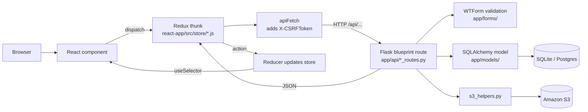
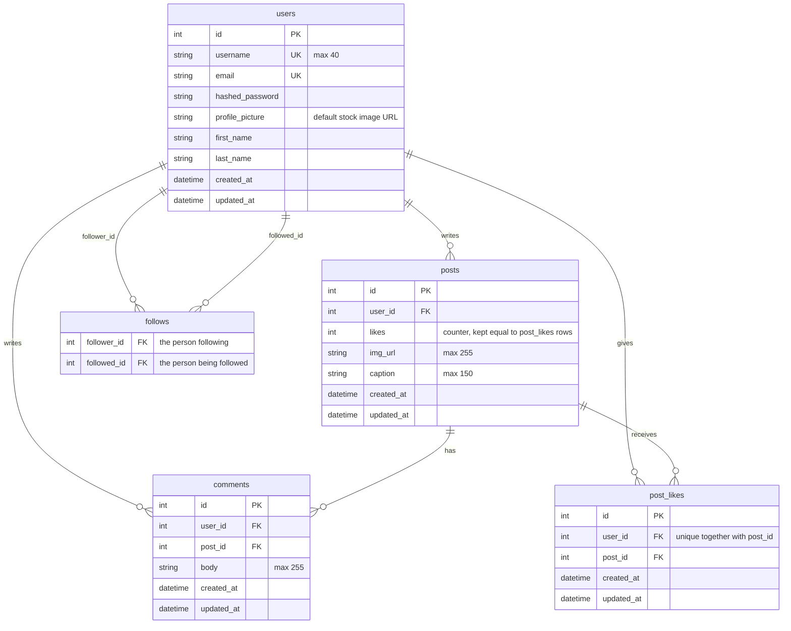
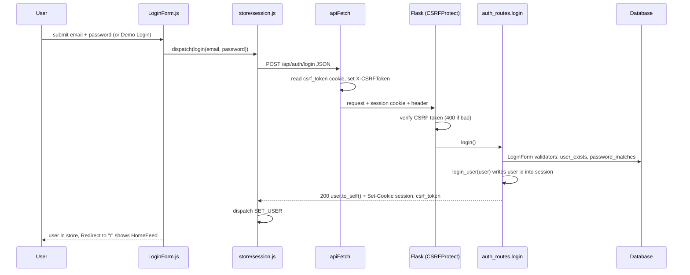
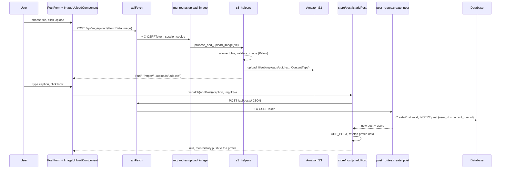

# Postpix Code Walkthrough

A guided tour of the Postpix codebase as it is **today on the `modernize` branch** (after
Batch 1, items P2-P11). It is written for someone who knows Python and React basics but has
not looked at this project in a while. Every file, function and endpoint named here exists in
the code; if you find one that does not, the code changed after this was written.

Postpix started in 2022 as a three-person team project (Tyler, Alan De Leon, Theo Fandrich)
and is now maintained by Tyler. See `CHANGES.md` for what Batch 1 changed and
`MODERNIZATION_PLAN.md` for what is planned.

## Table of contents

1. [The app in one minute](#1-the-app-in-one-minute)
2. [Folder map](#2-folder-map)
3. [How to run it locally](#3-how-to-run-it-locally)
4. [Data model](#4-data-model)
5. [Backend tour](#5-backend-tour)
6. [Authentication and security flow](#6-authentication-and-security-flow)
7. [Frontend tour](#7-frontend-tour)
8. [Three end-to-end traces](#8-three-end-to-end-traces)
9. [Where do I look when...](#9-where-do-i-look-when)
10. [What changed in Batch 1 and what is coming](#10-what-changed-in-batch-1-and-what-is-coming)
11. [Interview prep](#11-interview-prep)
12. [Glossary](#12-glossary)

---

## 1. The app in one minute

Postpix is a photo-sharing web app. You sign up (optionally with a profile picture) or click
**Demo Login**, then you can:

- see a **home feed** of posts from people you follow,
- browse every post on the **explore** page,
- open a post in a **modal** to like it, see who liked it, and read/write/edit/delete comments,
- **create a post** by uploading an image (stored in Amazon S3) and writing a caption,
- edit or delete your own posts' captions,
- visit **profiles**, see follower/following lists, and follow/unfollow people,
- **search** users by username from the nav bar.

**Stack**

| Layer | Technology | Where |
|---|---|---|
| Frontend | React 17, React Router v5, Redux 4 + redux-thunk, Create React App (react-scripts 4) | `react-app/` |
| Backend | Flask 2.0, Flask-SQLAlchemy 2.5 (SQLAlchemy 1.4), Flask-Migrate (Alembic), Flask-Login, Flask-WTF | `app/` |
| Database | SQLite locally (`app/dev.db`), Postgres in production | `migrations/` |
| Images | Amazon S3 via `boto3`, validated with Pillow | `app/s3_helpers.py` |
| Deploy (old) | Docker image on Heroku via GitHub Actions (Heroku is dead) | `Dockerfile`, `.github/workflows/main.yml` |

**How a request flows**



In words: a component calls `dispatch(someThunk())`. The thunk calls `apiFetch('/api/...')`.
Flask routes the URL to a function in one of the blueprints under `app/api/`. That function
checks login (`@login_required`), validates input with a WTForm, reads/writes models through
SQLAlchemy, and returns a Python `dict`, which Flask turns into JSON. The thunk then dispatches
a plain action, a reducer stores the data, and every component that `useSelector`s that slice
re-renders.

---

## 2. Folder map

Skips `node_modules/`, `react-app/build/`, lockfiles and `__pycache__/`.

```text
Instagram-Group-Project/
├── .env.example              Template for your local .env (the only env template; copy it)
├── .envexample               Git-ignored leftover duplicate (P2 stopped tracking it); safe to delete
├── .github/workflows/main.yml Old Heroku deploy: build, migrate, seed undo, seed all (wipes data!)
├── CHANGES.md                What Batch 1 changed, item by item, and how to verify it
├── MODERNIZATION_PLAN.md     The 48-item plan (P1-P48)
├── Dockerfile                Old Heroku image (python:3.9, gunicorn app:app)
├── Pipfile                   Old pipenv file, out of date; requirements.txt is the real list
├── requirements.txt          Pinned backend packages (Flask 2.0.1, SQLAlchemy 1.4.19, Pillow...)
├── README.md                 Original team README (rewrite planned in P46)
├── app/                      Flask backend
│   ├── __init__.py           Creates the Flask app: config, login manager, blueprints, CSRF, React serving
│   ├── config.py             Config class: SECRET_KEY, DATABASE_URL, cookies, 10 MB upload cap
│   ├── errors.py             JSON error handlers ({"errors": [...]}) for every /api error
│   ├── s3_helpers.py         Image validation (Pillow) + upload to S3
│   ├── dev.db                Local SQLite database (git-ignored, created by flask db upgrade)
│   ├── api/                  Blueprints = groups of routes
│   │   ├── auth_routes.py    /api/auth: restore session, login, logout, signup
│   │   ├── user_routes.py    /api/users: users, profiles, follow/unfollow, liked posts
│   │   ├── post_routes.py    /api/posts: post CRUD, likes, comments on a post
│   │   ├── comment_routes.py /api/comments: edit/delete a comment
│   │   ├── me_routes.py      /api/me/following/posts: the home feed
│   │   └── img_routes.py     /api/img/upload: upload one image to S3
│   ├── forms/                Flask-WTF forms (input validation)
│   │   ├── login_form.py, signup_form.py
│   │   ├── create_post.py, update_post.py, create_comment.py, update_comment.py
│   │   └── filters.py        strip_whitespace filter used by text fields
│   ├── models/               SQLAlchemy models (tables)
│   │   ├── db.py             The db object + production schema helper add_prefix_for_prod
│   │   ├── user.py           User model + the follows association table
│   │   ├── posts.py          Post
│   │   ├── comments.py       Comment
│   │   ├── postLike.py       PostLike (one row per like)
│   │   └── follows.py        Entirely commented out (old Follow model); not imported
│   └── seeds/                `flask seed all` / `flask seed undo` demo data
│       ├── __init__.py       Defines the seed CLI group
│       ├── users.py          15 users (+ who follows whom)
│       ├── posts.py          50 posts
│       ├── comments.py       ~80 comments
│       ├── postLikes.py      17 likes + recount_post_likes()
│       └── follows.py        Dead code (imports a name that does not exist); not imported
├── migrations/               Alembic (Flask-Migrate) schema history
│   ├── env.py                Creates/uses the Postgres SCHEMA in production
│   └── versions/             5 migration files (see section 5)
└── react-app/                React frontend (Create React App)
    ├── package.json          Deps + "proxy": "http://localhost:5000"
    ├── public/index.html     HTML shell, <title>Postpix</title>
    └── src/
        ├── index.js          Entry: Redux Provider + ModalProvider + <App/>
        ├── App.js            Restores session, then defines routes
        ├── index.css         Global styles + Postpix brand CSS variables (--pp-accent)
        ├── utils/apiFetch.js fetch wrapper that adds the CSRF header
        ├── context/Modal.js  ModalProvider + <Modal> (portal-based modal)
        ├── store/            Redux: index.js combines 14 slice reducers (see section 7)
        └── components/
            ├── LoginPage/    Login card, Demo Login, sign-up modal, profile-picture picker
            ├── NavBar/       Nav bar, search, create-post modal, image upload, profile menu
            ├── HomeFeed/     Home page: following avatars, feed, suggestions sidebar
            ├── ExplorePage/  Grid of all posts
            ├── UserProfile/  Profile header (follow button, counts) + post grid
            ├── reUsedComponents/ PostGrid, SinglePostModal, comments, edit/delete modals,
            │                 follower/following/liked-by lists, ProtectedRoute
            ├── Brand/        Wordmark.js (the "postpix" text logo) + Brand.css
            ├── User.js, UsersList.js  Early dev pages (UsersList is routed at /users)
            └── Temp*/, CreatePost/, CreateComment/  Unused dev test components
```

---

## 3. How to run it locally

You need two terminals: one for Flask (port 5000) and one for the React dev server
(port 3000). The React dev server forwards `/api/...` calls to Flask.

1. **Create your `.env`** in the project root:
   ```bash
   cp .env.example .env
   ```
2. **Set a real `SECRET_KEY`.** Generate one and paste it into `.env`:
   ```bash
   python3 -c "import secrets; print(secrets.token_hex(32))"
   ```
   If you leave `SECRET_KEY` empty in development, `app/config.py` makes a random key **each
   time Flask starts**, so every restart logs you out and invalidates CSRF tokens. Keep
   `FLASK_ENV=development` and `DATABASE_URL=sqlite:///dev.db` (this creates `app/dev.db`).
3. **S3 (optional).** If you are not testing uploads, set `S3_BUCKET=` to empty. Then uploads
   fail cleanly with "S3 is not configured" instead of trying a fake bucket. Everything else
   works without S3 (seed images are hosted elsewhere). `REACT_APP_BASE_URL` is not used by the code.
4. **Create a virtualenv and install backend packages.** The pins date from 2021-2022 and the
   Dockerfile uses Python 3.9, so Python 3.9 (3.10/3.11 likely fine) is the safe choice until
   P13 upgrades everything:
   ```bash
   python3.9 -m venv .venv
   source .venv/bin/activate
   pip install -r requirements.txt
   ```
5. **Create the tables** (Flask finds the app through `FLASK_APP=app` in `.env`, loaded by
   python-dotenv):
   ```bash
   flask db upgrade
   ```
6. **Load demo data:**
   ```bash
   flask seed all
   ```
   Running it twice fails on unique usernames/emails. To start over: `flask seed undo` then
   `flask seed all` (or delete `app/dev.db` and repeat step 5).
7. **Start Flask:**
   ```bash
   flask run        # http://localhost:5000
   ```
8. **Start React** in a second terminal:
   ```bash
   cd react-app
   npm install
   npm start        # http://localhost:3000
   ```
   On Node 17 or newer, react-scripts 4 needs `NODE_OPTIONS=--openssl-legacy-provider npm start`.
9. **How the proxy works.** `react-app/package.json` has `"proxy": "http://localhost:5000"`.
   The browser only talks to `localhost:3000`; the CRA dev server forwards `/api/...` to Flask.
   Because the browser sees one origin, cookies (session + CSRF) just work and no CORS is needed.
10. **Log in.** Click **Demo Login** (it calls `login("demo@aa.io", "password")` in
    `LoginForm.js`). Every seeded user has password `password`, for example
    `marnie@aa.io`, `bobbie@aa.io`, `theo@aa.io`, `awd@aa.io` (see `app/seeds/users.py`).

**Production-style run:** `npm run build` inside `react-app/`, then only `flask run`; Flask serves
`react-app/build/` itself (see section 5). Deep links like `/explore` 404 on refresh in this mode.

---

## 4. Data model

Five tables. `follows` is a plain association table (no model class); the other four are
models in `app/models/`.



**Two many-to-many relationships**

- **Users like posts** through `post_likes`. It is a full model (`PostLike`) with its own `id`
  and timestamps. Since P6 a unique constraint `uq_post_likes_user_post` on
  `(user_id, post_id)` makes double-likes impossible.
- **Users follow users** through `follows` (self-referential many-to-many: both columns point
  at `users.id`). It has a unique constraint on `(follower_id, followed_id)` but no primary key.

**Per model file**

- `app/models/db.py` - creates `db = SQLAlchemy()`. Also reads `FLASK_ENV` and `SCHEMA`;
  `add_prefix_for_prod('users.id')` returns `"<SCHEMA>.users.id"` in production so foreign keys
  point into the Postgres schema (a leftover of App Academy's Heroku setup; removed in P15).
- `app/models/user.py` - the `follows` table and the `User` model.
  - `password` is a property: setting `user.password = 'x'` stores a Werkzeug hash in
    `hashed_password`; `check_password()` verifies it.
  - `UserMixin` from Flask-Login gives `is_authenticated`, `get_id()` and so on.
  - `followers` = users who follow me (`follows.followed_id == my id`). Its backref
    **`follows`** = users **I** follow. Both are `lazy='dynamic'` (query objects). The naming is
    confusing: read `user.follows` as "the people this user follows".
  - `to_public()` - safe view: id, username, names, picture, followers, following, liked
    post IDs, timestamps. **No email.** `to_dict` is an alias of `to_public`.
  - `to_self()` - `to_public()` plus `email`; only used for "this is me" responses.
  - Cascades: deleting a user deletes their posts, comments and likes.
- `app/models/posts.py` - `Post`, with `users` (the author; note the plural name),
  `comments` and `post_likes` (both cascade-delete with the post). `to_dict()` returns
  camelCase keys (`userId`, `imgUrl`, `createdAt`).
- `app/models/comments.py` - `Comment`, with `users` (author) and `posts`.
- `app/models/postLike.py` - `PostLike` plus the unique constraint.
- `app/models/follows.py` - fully commented out; ignore it.
- `app/models/__init__.py` - re-exports `db, User, Post, Comment, PostLike`.

---

## 5. Backend tour

### 5.1 `app/__init__.py`, step by step

There is no app factory yet (that is P12): importing the `app` package builds one global
`app` object. `flask run` and gunicorn (`gunicorn app:app`) both import it.

1. **Imports models and blueprints.** `from .models import db, User` and one import per
   blueprint file in `app/api/`, plus `seed_commands`, `Config`, `IS_PRODUCTION` and
   `register_error_handlers`.
2. **Creates the app:** `Flask(__name__, static_folder='../react-app/build', static_url_path='/')`.
   This tells Flask that the built React files are static files served from the site root.
3. **Login manager.** `login = LoginManager(app)`.
   - `@login.user_loader load_user(id)` - on every request with a session cookie, Flask-Login
     calls this with the stored user id and gets the `User` back. That is what fills
     `current_user`.
   - `@login.unauthorized_handler unauthorized()` - when `@login_required` fails, return
     `{"errors": ["Unauthorized"]}, 401` (JSON, not a redirect). `login.login_view` is still set
     but the handler takes precedence.
4. **Seed CLI.** `app.cli.add_command(seed_commands)` adds `flask seed all|undo`.
5. **Config.** `app.config.from_object(Config)` (from `app/config.py`):
   - `SECRET_KEY` - required in production (startup fails without it), random per process in dev.
   - `SQLALCHEMY_DATABASE_URI` from `DATABASE_URL` (default `sqlite:///dev.db`; rewrites
     `postgres://` to `postgresql://`).
   - `SQLALCHEMY_ECHO` from the env, default off.
   - `MAX_CONTENT_LENGTH = 10 MB` - bigger request bodies get 413.
   - Session and remember-me cookies: `HttpOnly`, `SameSite=Lax`, `Secure` only in production.
6. **Blueprints.** Six `register_blueprint` calls mount the route files under
   `/api/users`, `/api/auth`, `/api/posts`, `/api/me`, `/api/comments`, `/api/img`.
7. **Extensions.** `db.init_app(app)` connects SQLAlchemy; `Migrate(app, db)` adds `flask db ...`.
8. **CSRF.** `csrf = CSRFProtect(app)` checks a CSRF token on **every** POST/PUT/PATCH/DELETE.
   (flask-cors was removed in P9; same-origin needs no CORS.)
9. **Error handlers.** `register_error_handlers(app)` from `app/errors.py`:
   - `handle_http_exception` - for `/api/...` paths turns any `HTTPException` (404, 405, 413...)
     into `{"errors": [description]}` with the right status. Non-API paths keep Flask's default.
   - `handle_unexpected_exception` - logs the traceback, returns a generic
     `{"errors": ["Internal server error"]}, 500`. In debug/testing it re-raises so you see the traceback.
   - Plus `handle_csrf_error` in `__init__.py`: `{"errors": ["CSRF check failed: ..."]}, 400`.
10. **`inject_csrf_token` (after every response)** sets the `csrf_token` cookie to
    `generate_csrf()`, `SameSite=Lax`, `httponly=False` so JavaScript can read it.
11. **Serving React.** `react_root(path)` is mapped to `/` and `/<path:path>`:
    `api/...` paths get a JSON 404, `favicon.ico` is sent as a file, and anything else returns
    `index.html` so React Router can take over. **Catch:** because `static_url_path='/'`,
    Flask's own static route also matches `/<path:filename>` and wins, so a refresh on
    `/explore` looks for a file called `explore`, does not find it, and returns 404 (known
    issue, noted in `CHANGES.md` P11; fix planned in P31/P33). Only `/` reliably reaches
    `react_root`. This only matters when Flask serves the build; `npm start` is unaffected.

### 5.2 Forms (`app/forms/`)

Flask-WTF forms validate incoming data. They read `request.form` (multipart/urlencoded) **or a
JSON body**, which is why the frontend can post JSON to them. `validate_on_submit()` is true only
for a POST/PUT with valid data. Because `CSRFProtect` already checked the token for the whole
request, the forms' own CSRF field passes automatically.

| Form | Fields and rules | Used by |
|---|---|---|
| `LoginForm` | `email` (required, custom `user_exists`), `password` (required, `password_matches` checks the hash) | `POST /api/auth/login` |
| `SignUpForm` | `username` (<=40, unique), `email` (<=255, valid, unique), `password` (8-128), `first_name`, `last_name` (<=255) | `POST /api/auth/signup` |
| `CreatePost` | `img_url` (<=255), `caption` (<=150), both required | `POST /api/posts/` |
| `UpdatePost` | `caption` (<=150) | `PUT /api/posts/<id>` |
| `CreateComment` / `UpdateComment` | `body` (<=255) | comment create / edit |

Text fields use `strip_whitespace` from `filters.py`, so `"   "` becomes empty and fails
`DataRequired`. Each route file has its own copy of `validation_errors_to_error_messages()`,
which turns `form.errors` into `["field : message", ...]`.

### 5.3 Every API endpoint

"Login" = has `@login_required` (logged-out callers get 401 JSON). "Owner" = the route checks
the current user owns the row (403 if not). All write methods also need the CSRF header.

**`app/api/auth_routes.py` (`/api/auth`)**

| Method | Path | Login | Owner | Handler | Models | Response |
|---|---|---|---|---|---|---|
| GET | `/api/auth/` | no | - | `authenticate` | User, Post | `to_self()` + `Posts: [post]`; if logged out **200** with `{"errors": ["Unauthorized"]}` |
| POST | `/api/auth/login` | no | - | `login` | User | `to_self()`; 400 `{"errors": [...]}` |
| POST | `/api/auth/logout` | no | - | `logout` | - | `{"message": "User logged out"}` |
| POST | `/api/auth/signup` | no | - | `sign_up` | User (+S3) | multipart in; `to_self()`; 400 on form errors; upload errors keep their status (400/502) |
| GET | `/api/auth/unauthorized` | no | - | `unauthorized` | - | 401 `{"errors": ["Unauthorized"]}` |

**`app/api/user_routes.py` (`/api/users`)**

| Method | Path | Login | Owner | Handler | Models | Response |
|---|---|---|---|---|---|---|
| GET | `/api/users/` | yes | - | `users` | User | `{"users": [to_public]}` |
| GET | `/api/users/<id>` | yes | - | `user` | User, Post | `to_public()` + `Posts: [post]`; 404 |
| DELETE | `/api/users/<id>` | yes | self only | `delete_user` | User (cascades) | `{"message": "Success"}`; 403. No frontend button calls this |
| GET | `/api/users/<id>/followers` | yes | - | `get_followers` | User, follows | `{"followers": [{userId, username, profilePicture}]}`; 404 |
| GET | `/api/users/<id>/following` | yes | - | `get_following` | User, follows | `{"following": [...same shape]}`; 404 |
| GET | `/api/users/<id>/notfollowing` | yes | - | `get_not_following` | User | `{"users": [to_public]}` = everyone user `<id>` does not follow (minus themself) |
| POST | `/api/users/<id>/follow` | yes | - | `follow_user` | User, follows | `{"currentUser", "followingUser"}` (both `to_public`); 409 if already following; 404 |
| DELETE | `/api/users/<id>/follow` | yes | - | `unfollow_user` | User, follows | same shape; 409 if not following; 404 |
| GET | `/api/users/<id>/likes` | yes | - | `get_all_liked_posts` | User, PostLike, Post | `{"likedPosts": [post]}`; unused by the frontend |
| GET | `/api/users/likes` | yes | - | `get_posts_liked` | User, PostLike, Post | current user's `{"likes": [{postId, likes}]}` |

**`app/api/post_routes.py` (`/api/posts`)**

| Method | Path | Login | Owner | Handler | Models | Response |
|---|---|---|---|---|---|---|
| GET | `/api/posts/` | yes | - | `posts` | Post, User | `{"Posts": [post + users{username, profilePicture, userId}]}`, newest first |
| GET | `/api/posts/<id>` | yes | - | `get_post_by_id` | Post, User | post + `users`; 404 |
| POST | `/api/posts/` | yes | - | `create_post` | Post | the new post + `users`; 400 |
| PUT | `/api/posts/<id>` | yes | yes | `update_post` | Post, User | post + `users`; 404 / 403 / 400 |
| DELETE | `/api/posts/<id>` | yes | yes | `delete_post` | Post (cascades comments, likes) | `{"message": "Success"}`; 404 / 403 |
| GET | `/api/posts/<id>/likes/users` | yes | - | `get_user_liked` | Post, PostLike, User | `{"user": [{id, username, profilePicture}]}`; 404 |
| POST | `/api/posts/<id>/likes` | yes | - | `like_post` | PostLike, Post | `{"likes": n, "postId": id}`; **409** if already liked; 404 |
| DELETE | `/api/posts/<id>/likes` | yes | own like | `unlike_post` | PostLike, Post | `{"postId", "likes"}` (new count); 404 if you had not liked it |
| GET | `/api/posts/<id>/comments` | yes | - | `comments_on_post` | Comment, User | `{"Comments": [comment + users{username, id, profilePicture} + myComment]}` |
| POST | `/api/posts/<id>/comments` | yes | - | `create_comment_post` | Comment | comment + `myComment: true` + `users{userId, username, profilePicture}`; 400 / 404 |

Note the small inconsistency: comments from `GET` have `users.id`, comments from `POST`/`PUT`
have `users.userId`.

**`app/api/comment_routes.py` (`/api/comments`)**

| Method | Path | Login | Owner | Handler | Models | Response |
|---|---|---|---|---|---|---|
| PUT | `/api/comments/<id>` | yes | yes | `update_comment` | Comment, User | comment + `users` + `myComment`; 404 / 403 / 400 |
| DELETE | `/api/comments/<id>` | yes | yes | `delete_comment` | Comment | `{"message": "Success"}`; 404 / 403 |

**`app/api/me_routes.py` (`/api/me`) and `app/api/img_routes.py` (`/api/img`)**

| Method | Path | Login | Owner | Handler | Models | Response |
|---|---|---|---|---|---|---|
| GET | `/api/me/following/posts` | yes | - | `me_following_posts` | Post, follows, User | `{"Posts": [post + users]}`; only followed users, newest first, **not your own posts** |
| POST | `/api/img/upload` | yes | - | `upload_image` | (S3) | multipart field `image`; `{"url": "https://..."}`; 400 / 413 / 502 |

How the home feed query works (P10): a subquery
`SELECT followed_id FROM follows WHERE follower_id = <me>` feeds
`Post.user_id.in_(...)`, ordered by `created_at DESC, id DESC`, with `selectinload(Post.users)`
so authors load in one extra query instead of one per post.

How likes stay correct (P6): `like_post` refuses a duplicate (409), increments in SQL
(`likes = coalesce(likes, 0) + 1`) so concurrent likes do not overwrite each other, and catches
`IntegrityError` from the unique constraint as a 409 too. `unlike_post` decrements in SQL (never
below 0) and `db.session.refresh(post)` so the response has the new count.

### 5.4 `app/s3_helpers.py`

The S3 client is created at import time from `S3_KEY`/`S3_SECRET` (if empty, boto3 falls back
to its normal credential chain, e.g. an EC2 role later). One public function does everything:

`process_and_upload_image(file)`:
1. no file -> 400 "image required";
2. `allowed_file(filename)` - quick extension check (png, jpg, jpeg, gif, webp) -> 400;
3. `validate_image(file)` - opens the stream with Pillow and `verify()`s it; the **detected**
   format (not the file name or browser claim) picks the extension and `Content-Type`; refuses
   non-images and huge pixel counts (`Image.MAX_IMAGE_PIXELS = 50_000_000`) -> 400;
4. `get_unique_filename(ext)` - `uploads/<uuid4 hex>.<ext>`;
5. `upload_file_to_s3(file, key, content_type)` - `s3.upload_fileobj` with no ACL. Returns
   `{"url": S3_LOCATION + key}` where `S3_LOCATION` is `S3_PUBLIC_URL_BASE` or
   `https://<bucket>.s3.amazonaws.com/`. If `S3_BUCKET` is empty or AWS errors, returns an error
   which becomes **502** (the real AWS error is only printed on the server).

Used by `upload_image` (`/api/img/upload`) and by `sign_up` (profile picture).

### 5.5 Seeds and migrations

**Seeds (`app/seeds/`)** fill the database with demo data. `flask seed all` runs, in order,
`seed_users()` (15 users, all password `password`, and the follow graph set via
`user.followers = [...]`), `seed_posts()` (50 posts), `seed_comments()`, `seed_post_likes()`
(17 likes, then `recount_post_likes()` sets every `posts.likes` from real rows). Seed profile
pictures point at an S3 bucket owned by someone else (`capstone-strava-clone-aktiv`); P37 plans
to copy them.

`flask seed undo` runs `undo_users()` (deletes users **and** follows), `undo_posts()`,
`undo_comments()`, `undo_post_likes()` with raw `DELETE FROM ...` SQL.

In production (`FLASK_ENV=production`), `flask seed all` **first runs
`TRUNCATE ... RESTART IDENTITY CASCADE`** on users, posts, comments and post_likes.

> **Data-loss warning.** `.github/workflows/main.yml` runs on every push to `main`:
> build React, push a Docker image to Heroku, `flask db upgrade`, then **`flask seed undo`** and
> **`flask seed all`**. So every deploy deleted every user, post, comment and like (real
> sign-ups included) and replaced them with demo data. Heroku is gone so this no longer runs
> anywhere real, but do not point it at a live database. P39 replaces this workflow and P41
> adds a safe "reset only the demo account" command.

**Migrations (`migrations/versions/`)** are the schema history, applied in order by
`flask db upgrade`:

| Revision | What it does |
|---|---|
| `bd907f496434` (2022-10-24) | Initial tables: users, followers, posts, comments, post_likes |
| `8e380edbf296` (2022-10-25) | Creates `follows`, drops the old `followers` table |
| `356ea97f15e1` (2022-10-27) | Adds `users.profile_picture` |
| `e66be29cbd54` (2022-11-05) | Empty (no-op) |
| `a1f3c9d2e7b4` (2026-11-23, P6) | Removes duplicate likes, adds `uq_post_likes_user_post`, recounts `posts.likes` |

The older files contain `ALTER TABLE ... SET SCHEMA` lines for production, and
`migrations/env.py` creates the schema and sets `search_path` in production. P15 plans to reset
this chain into one clean initial migration.

To change the schema: edit a model, run `flask db migrate -m "message"`, **read** the generated
file, then `flask db upgrade`.

---

## 6. Authentication and security flow

### 6.1 The two cookies

| Cookie | Set by | Readable by JS? | Purpose |
|---|---|---|---|
| `session` | Flask (signed with `SECRET_KEY`) | no (`HttpOnly`) | Holds the logged-in user id after `login_user()`. Sent automatically with every request |
| `csrf_token` | `inject_csrf_token` in `app/__init__.py`, on every response | yes (on purpose) | A signed CSRF token. `apiFetch` copies it into the `X-CSRFToken` header |

Flask-WTF also keeps the raw CSRF secret inside the session. On a POST/PUT/PATCH/DELETE,
`CSRFProtect` checks that the `X-CSRFToken` header is a valid, unexpired token that matches the
session. Another website can make your browser **send** cookies but cannot **read** them, so it
cannot put the right value in the header. That is the protection. Missing or wrong header =
400 `CSRF check failed`.

### 6.2 Restore (page load)

`App.js` runs `dispatch(authenticate())` once on mount and renders nothing until it finishes.
`authenticate` (in `store/session.js`) calls `GET /api/auth/`. If the session cookie is valid,
the backend returns `current_user.to_self()` plus `Posts`, and `SET_USER` stores it in
`state.session.user`. If not, the backend returns 200 with `{"errors": [...]}` and the thunk
simply does not set a user, so the login page shows. This GET response also sets the first
`csrf_token` cookie.

### 6.3 Login



On a validation error the route returns 400 `{"errors": ["email : Email provided not found."]}`
and `LoginForm` shows the messages.

### 6.4 Signup (multipart, optional image)

`SignUpForm.js` checks the two passwords match, then calls
`signUp(username, email, password, first_name, last_name, image)`. The thunk builds a
`FormData` (all fields + optional `image` file from `ProPicImageUpload`) and posts it to
`/api/auth/signup` with `apiFetch` (no `Content-Type` header, so the browser sets the multipart
boundary). `sign_up()` validates `SignUpForm` **first**, then, if an image was sent, calls
`process_and_upload_image()`; only then creates the `User`, commits, `login_user(user)`, and
returns `to_self()`. On success the form navigates to `/explore`. Why one request: since P3
`/api/img/upload` needs a logged-in user, and a new user is not logged in yet.

### 6.5 Logout

`ProfileDropDownMenu.js` (and the unused `LogoutButton.js`) dispatch `logout()`, which sends
`POST /api/auth/logout` (POST since P4, so an `` tag on another site cannot log you out).
`logout_user()` clears the session; the reducer sets `user` to `null`; the routes fall back to
the login page.

### 6.6 What protects each route

- **Logged in?** `@login_required` on every `/api/users`, `/api/posts`, `/api/comments`,
  `/api/me`, `/api/img` route. Failure: 401 JSON from `unauthorized()`.
- **Owner?** Checked inside the handler by comparing `current_user.id` with the row's
  `user_id`: `update_post`, `delete_post`, `update_comment`, `delete_comment`, `delete_user`
  (self only), `unlike_post` (can only delete your own like row). Failure: 403 (or 404 if the row
  does not exist).
- **Valid input?** WTForms with length limits (section 5.2) and Pillow for images.
- **CSRF?** `CSRFProtect` on every write.
- **Private data?** `to_public()` everywhere (no email); `to_self()` only in `authenticate`,
  `login`, `sign_up`.
- **Frontend guard:** `ProtectedRoute.js` renders its children only if `state.session.user`
  exists, else `<Redirect to="/" />`. This is a convenience only; the real security is on the server.

---

## 7. Frontend tour

### 7.1 Entry point

`react-app/src/index.js` creates the Redux store with `configureStore()` and renders
`<Provider store>` > `<ModalProvider>` > `<App />`.

`context/Modal.js`: `ModalProvider` renders an empty `<div>` after the app and shares it via
context; `<Modal onClose>` uses `ReactDOM.createPortal` to draw a background (click = close)
and content into that div. Every popup (post modal, create post, edit caption, liked-by list,
follower lists, sign up) uses it.

### 7.2 Routes (`App.js`)

`App` waits for `authenticate()`, shows `<NavBar />` only when logged in, then a `<Switch>`
(first match wins):

| URL | Component | Shows |
|---|---|---|
| `/users` | `ProtectedRoute` > `UsersList` | Early dev page: plain list of users. Its links go to `/users/<id>`, which matches no route (blank page) |
| `/explore` | `ProtectedRoute` > `ExplorePage` | Grid of every post (`PostGrid`) |
| `/:userId` | `ProtectedRoute` > `UserProfile` | A profile, e.g. `/1` is Demo. Catches **any** one-segment URL, so `/whatever` renders a broken profile (no 404 page yet; P31) |
| `/` (logged in) | `HomeFeed` | Following avatars, feed, sidebar |
| `/` (logged out) | `LoginPage` | Login card + sign-up modal |

`TempFollow`, `TempPost`, `TempComment` are imported but never rendered.

### 7.3 `utils/apiFetch.js`

`apiFetch(url, options)` is a thin wrapper around `fetch`. For any method other than
GET/HEAD/OPTIONS it reads the `csrf_token` cookie with `getCookie()` and adds the
`X-CSRFToken` header; it always sends `credentials: "same-origin"`. **Rule: every API call must
use `apiFetch`, never raw `fetch`, or writes fail with 400.**

### 7.4 Redux store map

`store/index.js` combines 14 slice reducers (`comments` is listed twice in `combineReducers`;
harmless). In development it also adds `redux-logger` (every action is logged in the console)
and Redux DevTools.

Each store file has the same pattern: action type constants, action creators, **thunks**
(`async (dispatch) => { apiFetch...; dispatch(action) }`) and a reducer. Most reducers store
items in an object keyed by id.

| State key | File | State shape | Thunks -> endpoint |
|---|---|---|---|
| `session` | `session.js` | `{ user: to_self() + Posts \| null }` | `authenticate` GET `/api/auth/`; `login` POST `/api/auth/login`; `logout` POST `/api/auth/logout`; `signUp` POST `/api/auth/signup` |
| `posts` | `post.js` | `{ [postId]: post + users }` (merged, never cleared) | `getAllPosts` GET `/api/posts/`; `addPost` POST `/api/posts/`; `updatePost` PUT `/api/posts/:id`; `deletePost` DELETE `/api/posts/:id` |
| `followingPosts` | `followingPosts.js` | `{ [postId]: post + users }` (replaced each load) | `getAllFollowingPosts` GET `/api/me/following/posts` |
| `currentPost` | `currentPost.js` | one post object | `getCurrentPost` GET `/api/posts/:id` |
| `comments` | `comments.js` | `{ [commentId]: comment }` | `getAllComments` GET / `postComment` POST `/api/posts/:id/comments`; `updateComment` PUT / `deleteComment` DELETE `/api/comments/:id`; `clearCommentsAction` (no API) |
| `follow` | `following.js` | `{ [userId]: {userId, username, profilePicture} }` | `getAllFollowing` GET `/api/users/:id/following`; `addFollowing` POST / `deleteFollowing` DELETE `/api/users/:id/follow` |
| `profileFollowing` | `profile_following_store.js` | same shape as `follow` | `getProfileFollowing` GET `/api/users/:id/following` |
| `followers` | `follower.js` | `{ [userId]: {...} }` | `getAllFollowers` GET `/api/users/:id/followers` |
| `notFollowed` | `nonFollowed.js` | `{ [userId]: to_public }` | `getNonFollowing` GET `/api/users/:id/notfollowing` |
| `users` | `users.js` | `{ [userId]: to_public }` | `getAllUsers` GET `/api/users/` |
| `searchUsers` | `search_users.js` | `{ [userId]: user }` | `setSearchUsers` (no API) |
| `profileUser` | `profileUser.js` | one `to_public()` + `Posts` | `getProfileUser` GET `/api/users/:id` |
| `userLikes` | `user_likes.js` | `{ [userId]: {id, username, profilePicture} }` (who liked one post) | `getLikesUser` GET `/api/posts/:id/likes/users` |
| `userPostLikes` | `user_post_like_list.js` | `{ [postId]: {postId, likes} }` (posts **I** liked) | `getUserLikedPostId` GET `/api/users/likes`; `addUserLikedPostId` POST / `deleteUserLikedPostId` DELETE `/api/posts/:id/likes` |

**How they overlap (and why it feels confusing).** The three authors each added small stores
as features grew, so the same data lives in several places:

- **Posts** live in `posts`, `followingPosts`, `currentPost`, `session.user.Posts` and
  `profileUser.Posts`. Nothing keeps them in sync; components re-fetch instead.
- **Following lists**: `follow` and `profileFollowing` call the **same endpoint**.
  `profileFollowing` is written but no component reads it.
- **Users**: `users` (all users, used by search and `PostGrid`), `notFollowed` (sidebar
  suggestions), `searchUsers` (written only by `SearchBar`'s `handleSearch`, which is not wired
  to anything, so it stays empty).
- **Likes**: `userPostLikes` (what I liked + counts) vs `userLikes` (who liked one post) vs the
  `likes` list inside `session.user`.
- **Refresh by re-fetching:** thunks dispatch other thunks after a write. For example
  `addPost` also dispatches `getAllFollowing`, `getAllFollowers`, `getProfileFollowing` and
  `getProfileUser`; `addFollowing(id)` re-fetches `getAllFollowing(id)`, `getAllFollowers(id)`
  and `getProfileUser(id)` for the **target** user (so the `follow` slice briefly holds the
  target's following list, not yours, until `CircleFaces` re-fetches on mount).
- **Object key order:** because slices are objects keyed by numeric id, `Object.values()`
  returns them in **ascending id order**, whatever order the server sent. Components then call
  `.reverse()`, so lists display highest id first, which approximates newest first.

P19 (optional) would move this to Redux Toolkit with normalized slices.

### 7.5 Key components

- **Nav bar** (`components/NavBar/index.js`): `Wordmark` logo (link to `/`), `SearchBar`, home
  icon, `PostFormModal` (plus icon), explore icon, `ProfileDropDownMenu` (profile link + log out).
- **Search** (`NavBar/SearchBar.js`): on mount dispatches `getAllUsers()` (all users), then
  filters **in the browser** by username prefix, shows up to 10 results; clicking one dispatches
  `getProfileUser(id)` and navigates to `/<id>`. Server-side search is P23.
- **Home feed** (`components/HomeFeed/`): `index.js` lays out `CircleFaces` (avatars of who you
  follow, from `follow`), `ActualFeed` (posts from `followingPosts`, loaded with
  `getAllFollowingPosts()`) and `SideStuff` (your card + `SideNonFollowedUsers` suggestions from
  `getNonFollowing`). In `ActualFeed` the heart icon is commented out, so the like area is an
  empty clickable `div`, and one `likePost` boolean is shared by all posts. **Liking works in the
  post modal, not the feed.** `PostSettingsModal` (three dots) links to the author's profile.
- **Explore** (`ExplorePage/index.js`): dispatches `getAllPosts()` and renders `PostGrid`.
- **PostGrid** (`reUsedComponents/PostGrid.js`): reads `userId` from the URL and
  `state.users[userId]`. If that user is found it shows only their posts (profile page),
  otherwise **all posts** (explore page, but also a profile page before `users` has loaded).
  Each tile is a `SinglePostModal`.
- **Post modal** (`reUsedComponents/SinglePostModal.js`): renders the thumbnail; click opens a
  `Modal` with the image, author, `EditCaptionThreeDotsModal` (edit/delete, only if
  `user.id === post.userId`), `CommentContainer` (loads `getCurrentPost` then `getAllComments`),
  the heart (`handleLikeButton`), `UserLikedListModal` (like count; click for who liked), the
  date, and the comment form (`submitComment` -> `postComment`). Each `SinglePostModal` calls
  `getUserLikedPostId()` on mount to decide if the heart starts filled, so a grid of 50 posts
  makes 50 identical `/api/users/likes` requests.
- **Edit/delete**: `EditCaptionForm.js` -> `updatePost`; `DeletePostModal/DeletePost.js` ->
  `deletePost`; `EditCommentForm.js` / `EditCommentModal.js` -> `updateComment` / `deleteComment`.
- **Profile** (`UserProfile/index.js` -> `UserInfoBox.js`): loads `getProfileUser(userId)`,
  decides `followTest` (am I in `profileUser.followers`?), shows the **Follow** / **Following**
  button (`handleFollow` -> `addFollowing`, `handleUnFollow` -> `deleteFollowing`), post count,
  `UserFollowerListModal` / `UserFollowingListModal`, and `PostGrid`.
- **Login page** (`LoginPage/`): `LoginForm.js` (login + Demo Login), `SignUpModal.js` ->
  `SignUpForm.js` + `ProPicImageUpload.js` (file picker with preview).

---

## 8. Three end-to-end traces

### 8.1 Logging in as demo

1. `App.js` mounted earlier and ran `authenticate()` -> `GET /api/auth/` -> logged out, so
   `state.session.user` is `null` and `/` renders `LoginPage`. That response set the
   `csrf_token` cookie.
2. User clicks **Demo Login** -> `demoLogIn()` in `LoginForm.js` ->
   `dispatch(login("demo@aa.io", "password"))`.
3. `login` thunk (`store/session.js`) -> `apiFetch("/api/auth/login", {method: "POST", body: JSON})`.
   `apiFetch` adds `X-CSRFToken`.
4. Flask: `CSRFProtect` validates the header -> `auth_routes.login()` -> `LoginForm()` reads
   the JSON -> `validate_on_submit()` runs `user_exists` and `password_matches`
   (`User.check_password`) -> `login_user(user)` stores the id in the session cookie ->
   returns `user.to_self()`.
5. Thunk: `response.ok` -> `dispatch(setUser(data))` -> `SET_USER` -> `state.session.user`.
6. `App` re-renders: `user` is set, so `<NavBar />` appears and `/` now renders `HomeFeed`.
   `LoginForm` also returns `<Redirect to="/" />`.
7. `HomeFeed` children mount and fetch: `CircleFaces` -> `getAllFollowing(user.id)`,
   `ActualFeed` -> `getAllFollowingPosts()`, `SideNonFollowedUsers` -> `getNonFollowing(...)`,
   and `SearchBar` -> `getAllUsers()`. From now on, `load_user()` in `app/__init__.py` turns the
   session cookie back into `current_user` on every request.

### 8.2 Creating a post with an image

Posting is **two requests**: upload the image first (get a URL), then create the post with that URL.

1. User clicks the plus icon -> `PostFormModal` opens a `Modal` with `PostForm`.
2. `PostForm` renders `ImageUploadComponent setUrl={setUrl}`. User picks a file (`updateImage`
   stores it) and clicks **Upload** -> `handleSubmit` builds `FormData` with field `image` and
   calls `apiFetch("/api/img/upload", {method: "POST", body: formData})`.
3. Flask: size check (`MAX_CONTENT_LENGTH`, else 413) -> CSRF check -> `@login_required` ->
   `img_routes.upload_image()` -> `process_and_upload_image()` -> `allowed_file`,
   `validate_image` (Pillow), `get_unique_filename`, `upload_file_to_s3` -> `{"url": "https://.../uploads/<uuid>.png"}`.
4. `ImageUploadComponent` calls `setUrl(url)` and shows a preview.
5. User types a caption and clicks **Post** -> `onPostSubmit` (alerts if no URL yet) ->
   `dispatch(addPost({userId, caption, imgUrl}))`.
6. `addPost` thunk -> `apiFetch("/api/posts/", {method: "POST", body: JSON {user_id, caption, img_url}})`.
   The server ignores `user_id` and uses `current_user.id`.
7. Flask: `post_routes.create_post()` -> `CreatePost` validates `img_url` and `caption` ->
   `Post(user_id=current_user.id, ...)` -> commit -> returns the new post + `users`.
8. Thunk: `ADD_POST` adds it to `posts`, then re-fetches `getAllFollowing`, `getAllFollowers`,
   `getProfileFollowing`, `getProfileUser` for the author and returns `null`.
9. `PostForm` sees `null` (success) -> `history.push("/<your id>")` -> `onClose()`. Your profile
   shows the new post in `PostGrid`. (It does not appear in your home feed: the feed only shows
   people you follow.)

If the user uploads an image but never clicks **Post**, the file stays in S3 unused.



### 8.3 Liking a post

Liking happens in the post modal (`SinglePostModal`), opened from the explore page or a profile grid.

1. When each `SinglePostModal` mounts it dispatches `getUserLikedPostId()` -> `GET /api/users/likes`
   -> `userPostLikes` becomes `{postId: {postId, likes}}` for posts you liked. If this post is
   in the list, local state `likePost` starts `true` (filled heart).
2. User opens the modal and clicks the heart -> `handleLikeButton` -> since `likePost` is false,
   `dispatch(addUserLikedPostId(post.id))`, then flips `likePost` to true immediately.
3. `addUserLikedPostId` -> `apiFetch("/api/posts/<id>/likes", {method: "POST"})` with CSRF header.
4. Flask: `post_routes.like_post(id)` -> `get_or_404` -> if a `PostLike` for (you, post)
   exists, 409 -> else add `PostLike`, `UPDATE posts SET likes = coalesce(likes,0) + 1` ->
   commit (an `IntegrityError` from the unique constraint also becomes 409) ->
   `refresh(post)` -> `{"likes": n, "postId": id}`.
5. Thunk (only if `response.ok`): `getCurrentPost(postId)` refreshes `currentPost`, and
   `ADD_LIKED_POST_ID` stores `{likes, postId}` in `userPostLikes`.
6. `UserLikedListModal` shows `userPostLikes[postId].likes` if you liked it, else
   `currentPost.likes`, so the number updates.
7. Clicking again does the reverse: `deleteUserLikedPostId` -> `DELETE /api/posts/<id>/likes`
   -> `unlike_post` -> new count -> `DELETE_LIKED_POST_ID` + `getCurrentPost`.

Note the heart is flipped before the server answers and is not flipped back on a 409/404, so the
icon can get out of sync with the database; a page reload fixes it (P31 plans proper optimistic updates).

---

## 9. Where do I look when...

| Symptom | Look at | Why |
|---|---|---|
| **400 `CSRF check failed`** on a POST/PUT/DELETE | `react-app/src/utils/apiFetch.js`, the calling store file, `app/__init__.py` (`inject_csrf_token`, `handle_csrf_error`) | The call used raw `fetch` (no header), the cookie was not set yet (no GET happened first), the token expired (tab open overnight: reload), or Flask restarted with a new random `SECRET_KEY` |
| Logged out every time Flask restarts (dev) | `.env` `SECRET_KEY`, `app/config.py` `_secret_key()` | Empty `SECRET_KEY` means a new random key per process, so old session cookies are invalid |
| **401 `Unauthorized`** from an API call | `@login_required` on the route, `unauthorized()` in `app/__init__.py`, `authenticate` in `store/session.js` | Not logged in or session cookie lost (different origin/port without the CRA proxy, or `Secure` cookies over plain HTTP in production) |
| **409** when liking | `like_post` in `app/api/post_routes.py`; `handleLikeButton` in `SinglePostModal.js` / `ActualFeed.js` | You already liked it. Usually the frontend's local `likePost` state is out of sync (it flips before the response; the feed shares one boolean for all posts) |
| **409** on follow/unfollow | `follow_user` / `unfollow_user` in `app/api/user_routes.py`; `followTest` in `UserInfoBox.js` | Already following / not following; the button state was computed from stale `profileUser.followers` |
| **413** on image upload | `MAX_CONTENT_LENGTH` in `app/config.py`, `app/errors.py` | Request body over 10 MB |
| **400** "file type not permitted" / "not a valid image" (there is no 415 in this code) | `allowed_file`, `validate_image` in `app/s3_helpers.py`; `accept=` on the file inputs | Wrong extension, or the bytes are not a real JPEG/PNG/WEBP/GIF |
| **502** "upload failed" / "S3 is not configured" | `upload_file_to_s3` in `app/s3_helpers.py`, `.env` `S3_BUCKET`/`S3_KEY`/`S3_SECRET`, Flask console (real AWS error is printed there) | Empty bucket name, bad credentials, or bucket permissions |
| Upload works but the image is broken (403 in Network tab) | S3 bucket policy (see `CHANGES.md` P7) | Uploads no longer send `public-read` ACL; the bucket needs a public-read policy on `uploads/*` or CloudFront (P37) |
| **Home feed empty** | `me_following_posts` in `app/api/me_routes.py`, `ActualFeed.js`, `followingPosts.js`, the `follows` table | Feed shows only users you follow, never your own posts; a new user follows nobody; or seeds did not run |
| Feed or grid order looks odd | `Object.values(...).reverse()` in `ActualFeed.js`, `PostGrid.js`, `ExplorePage/index.js` | Slices are objects keyed by id, so the server's order is lost and the display is "highest id first" |
| **404 on refresh of `/explore`** (or `/3`) when Flask serves the build | `Flask(..., static_url_path='/')` and `react_root` in `app/__init__.py` | Flask's static route catches the path before the React catch-all. Use `npm start` for dev or start from `/`. Fix planned P31/P33 |
| Profile page shows everyone's posts | `PostGrid.js` (`state.users[userId]`), `getAllUsers` in `SearchBar.js` | `PostGrid` falls back to all posts if `users` has not loaded that user yet |
| Blank page at `/users/3` or a broken profile at `/abc` | `App.js` routes | No `/users/:id` route; `/:userId` catches every one-segment URL; no 404 page yet |
| Login says "Email provided not found." for demo | `app/seeds/users.py`, your `DATABASE_URL` | Seeds not loaded into this database (run `flask db upgrade && flask seed all`) |
| **500** `Internal server error` | Flask console (`app.logger.exception` in `app/errors.py`) | The traceback is logged server-side only; in debug mode it is re-raised so you see it directly |
| Production container refuses to start | `app/config.py` | `FLASK_ENV=production` requires `SECRET_KEY` and `DATABASE_URL` (on purpose since P9) |
| All data gone after a deploy | `.github/workflows/main.yml`, `app/seeds/__init__.py` | The old workflow runs `flask seed undo` + `flask seed all` (which also TRUNCATEs in production) on every push to `main` |

---

## 10. What changed in Batch 1 and what is coming

Full details, verification steps and caveats are in `CHANGES.md`; the full plan is in
`MODERNIZATION_PLAN.md`.

**Batch 1 (done, on the current Flask 2.0 / SQLAlchemy 1.4 / CRA stack):**

- **P2** stopped tracking `app/dev.db`, `.pyc` files and `.envexample`; new `.gitignore`.
- **P3** owner checks on edit/delete, login required for create post and upload, signup
  picture moved into the signup request.
- **P4** `CSRFProtect` on for every write, `apiFetch` adds `X-CSRFToken`, logout is POST.
- **P5** `app/errors.py`: consistent JSON errors, 404/409 instead of 500s, JSON 401.
- **P6** one like per user per post (constraint + migration), race-safe counter, correct unlike count.
- **P7** upload hardening: 10 MB cap, Pillow validation, uuid keys, no ACL, HTTPS URLs.
- **P8** `to_public()` / `to_self()`, emails no longer exposed.
- **P9** config hardening (required secrets in production, cookie flags, echo off), CORS removed,
  `crypt` imports removed, form length limits and trimming.
- **P10** home feed in one query, newest first.
- **P11** original Postpix branding (wordmark, teal accent, favicon, demo note) to stop looking
  like Instagram's login page.

**P1 (Tyler action, no code):** the AWS key leaked in old git history belongs to the original
teammate; they must deactivate it. Also generate a new `SECRET_KEY`.

**Coming (Batch 2 and later):** app factory (P12), Python 3.12 / Flask 3 / SQLAlchemy 2 (P13-P14),
migration reset (P15), Vite + React 19 + Router v7 (P16-P18), optional Redux Toolkit (P19),
performance (P20-P26: lighter payloads, indexes, pagination, server search, image resizing),
UI/accessibility (P27-P32: viewport, responsive layout, accessible modals, 404 page, visual
refresh), Docker + AWS with CloudFront in front of S3 and EC2 (P33-P41, replacing the Heroku
workflow and adding backups and a demo reset), tests and CI (P42-P45), docs (P46-P48).

**Open questions from `CHANGES.md`:** show your own posts in the home feed? keep the teal
branding? rename the repo to `postpix`? fix the deep-link 404 early?

---

## 11. Interview prep

**Who built what (be accurate).** The original app (Oct 2022 - Feb 2023) was built by three
people. Commit counts on `main` up to `1e3945b`, by area, give a rough picture (commits are
not the same as lines or ownership, so check against your own memory):

| Area | Commits (Tyler / Alan / Theo) |
|---|---|
| `app/api` routes | 22 / 19 / 2 |
| `app/models` | 21 / 7 / 1 |
| `app/seeds` | 16 / 4 / 0 |
| `react-app/src/store` | 16 / 18 / 5 |
| `components/HomeFeed` | 10 / 2 / 13 |
| `components/reUsedComponents` | 18 / 23 / 14 |
| `components/NavBar` | 7 / 13 / 12 |
| `components/LoginPage` | 11 / 1 / 5 |

The Batch 1 commits on `modernize` (P2-P11, Nov 2026) are the maintenance work. If AI tools
helped with that work, say so plainly, and be ready to explain every change in your own words:
that is what the interviewer is testing.

**1. "Walk me through the architecture."**
Postpix is a React + Redux single-page app talking to a Flask JSON API. Components dispatch
thunks, thunks call a small `apiFetch` wrapper, Flask blueprints validate input with Flask-WTF,
use SQLAlchemy models, and return JSON. Images go to S3 and only the URL is stored in Postgres
(SQLite locally). In production Flask also serves the built React files, so it is all one origin.

**2. "How did you work as a team, and what is your role now?"**
It was a three-person bootcamp team project; we split work by feature, and each of us touched
both backend and frontend (the commit history shows much of my work in the routes, models, seeds and login page).
I now maintain it as my own repo: I audited it, wrote a 48-item modernization plan, and shipped
the first batch of security and bug fixes, each as its own commit with notes in `CHANGES.md`.

**3. "How does authentication work?"**
Session-based with Flask-Login. Login validates email and hashed password in a WTForm, then
`login_user()` stores the user id in a signed, HttpOnly session cookie. `load_user()` restores
`current_user` on each request; protected routes use `@login_required`, which returns a JSON
401. On page load React calls `GET /api/auth/` to restore the session.

**4. "How do you protect against CSRF?"**
Originally `CSRFProtect` was imported but never enabled, and the form check copied the cookie
into the form on the server, which proves nothing. I turned on `CSRFProtect` for every write;
Flask sends the token in a JS-readable cookie and `apiFetch` copies it into an `X-CSRFToken`
header. A malicious site can make the browser send cookies but cannot read them, so it cannot
forge the header. Cookies are also `SameSite=Lax`.

**5. "Tell me about a security bug you found and fixed."**
`PUT /api/posts/<id>` never checked ownership, so any logged-in user could edit anyone's caption
by changing the ID (an IDOR). The fix compares `post.user_id` with `current_user.id` and returns
403, with 404 for missing posts. The same audit found the upload endpoint had no login check,
so anyone could fill the S3 bucket.

**6. "How is the data modeled?"**
Users, posts, comments, likes and follows. Likes are a many-to-many between users and posts
through a `post_likes` model; follows is a self-referential many-to-many on users through a
`follows` association table. I added a unique constraint on `(user_id, post_id)` with a
migration that first removed duplicate rows and recounted the cached like counter.

**7. "How do image uploads work, and how do you make them safe?"**
The browser posts multipart form data to `/api/img/upload`; the server checks size (10 MB cap,
413), opens the file with Pillow to confirm it is really an image, takes the extension and
Content-Type from the detected format, names it `uploads/<uuid>`, and uploads to S3 with boto3.
The post itself stores only the returned URL. Never trusting the file name or browser
Content-Type stops someone hosting HTML on our bucket.

**8. "Did you find any performance problems?"**
The home feed did one query per followed user and returned results grouped by user instead of
by time (an N+1 pattern). I replaced it with one query using a subquery on `follows`, ordered by
`created_at`, with `selectinload` for authors: about 14 queries down to 3 for the demo user.
Next steps are lighter user payloads, indexes and pagination.

**9. "How does Redux fit in, and what would you change?"**
Each feature has a store file with action types, thunks for API calls, and a reducer keyed by
id. It grew organically across three people, so the same data (posts, following lists) lives
in several slices and components re-fetch to stay in sync. I would consolidate into normalized
slices, possibly with Redux Toolkit, and fix ordering by storing ids in arrays.

**10. "What would you do next / what are you proudest of?"**
Next is upgrading to supported versions (Python 3.12, Flask 3, SQLAlchemy 2, Vite, React 19),
adding pytest tests for the security fixes, and moving deployment from dead Heroku to Docker on
AWS behind CloudFront. I am proud that each fix is small, documented with how to verify it, and
reversible, and that I found real issues like a leaked key in git history and a deploy script
that wiped the database.

---

## 12. Glossary

- **Blueprint** - a Flask group of routes registered under a URL prefix (e.g. `post_routes` at `/api/posts`).
- **Route / view function** - a Python function Flask calls for a URL + method; returning a `dict` sends JSON.
- **ORM (SQLAlchemy)** - maps Python classes (models) to tables so you write `Post.query...` instead of SQL.
- **Model** - a class like `User` or `Post` that represents a table; each instance is a row.
- **Relationship / backref** - an attribute that loads related rows (`post.users`, `user.followers`); a backref creates the reverse attribute automatically (`user.follows`).
- **Many-to-many** - each user can like many posts and each post has many likers; stored in a middle table (`post_likes`, `follows`).
- **Association table** - a middle table with only foreign keys and no model class (`follows`).
- **Cascade** - deleting a parent row also deletes its children (a post's comments and likes).
- **Migration (Alembic / Flask-Migrate)** - a versioned script that changes the database schema; `flask db upgrade` applies them in order.
- **Seed** - demo data inserted by `flask seed all`.
- **Flask-Login** - extension that remembers who is logged in through the session cookie and provides `current_user` and `@login_required`.
- **Session cookie** - a cookie signed with `SECRET_KEY` holding the logged-in user id; can be read but not forged without the key.
- **Flask-WTF / WTForms** - form classes that validate input (`DataRequired`, `Length`, custom validators); Flask-WTF adds CSRF support.
- **CSRF** - cross-site request forgery: another site tricking your browser into making a request to Postpix with your cookies.
- **CSRF token** - a secret value the attacker cannot read; sent in the `X-CSRFToken` header and checked by `CSRFProtect`.
- **IDOR** - insecure direct object reference: acting on someone else's data by changing an ID.
- **N+1 query** - one query for a list plus one query per item; slow.
- **S3** - Amazon's file storage; files live in a "bucket" under a "key" like `uploads/abc.png`.
- **boto3** - the AWS SDK for Python, used to upload to S3.
- **ACL / bucket policy** - two ways to make S3 objects public; new buckets disable ACLs, so use a policy or CloudFront.
- **Redux store** - one JavaScript object holding app state, split into slices by `combineReducers`.
- **Action** - a plain object like `{type: "posts/ADD_POST", payload: post}` describing a change.
- **Reducer** - a pure function `(state, action) => newState` for one slice.
- **Thunk** - a function dispatched like an action that can do async work (API calls) and then dispatch real actions (redux-thunk middleware).
- **useSelector / useDispatch** - React-Redux hooks to read state and dispatch actions.
- **ProtectedRoute** - a wrapper route that redirects to `/` if no user is logged in.
- **Portal (modal)** - `ReactDOM.createPortal` renders the modal into a separate DOM node outside the component tree.
- **CRA proxy** - the `"proxy"` setting in `package.json` that forwards `/api` calls from port 3000 to Flask on port 5000 in development.
- **SPA deep link** - a URL like `/explore` that only exists in React Router; the server must return `index.html` for it.
