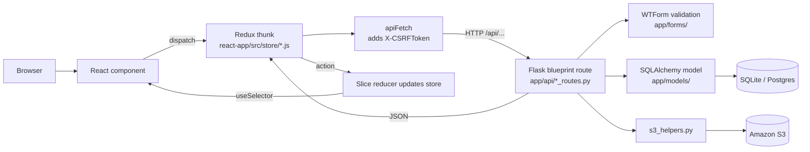
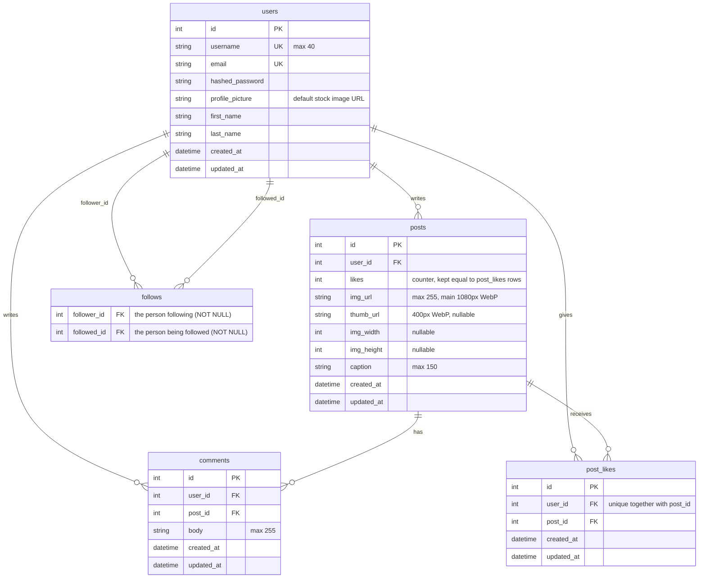
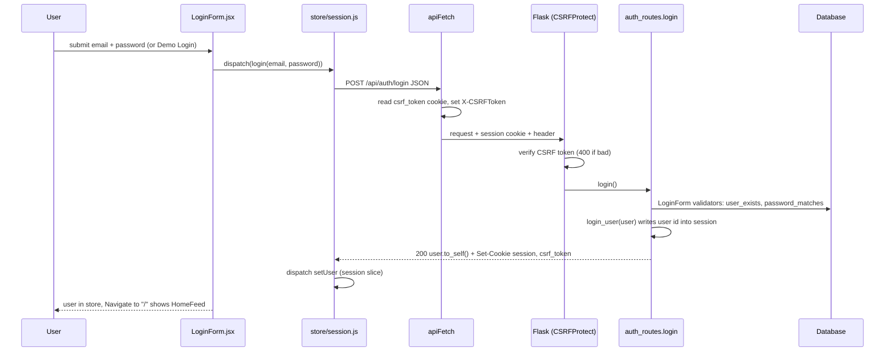
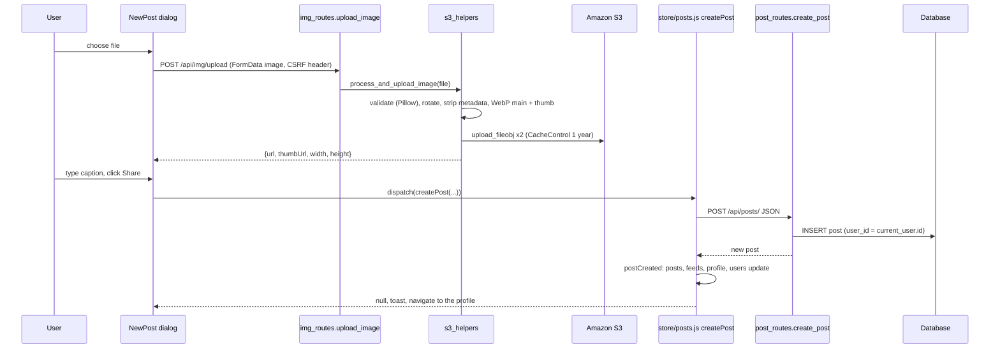

# PostPix Code Walkthrough

A guided tour of the PostPix codebase as it is **today on the `modernize` branch** (after
Batch 1, items P2-P11, Batch 2, items P0 and P12-P19, and Batch 3, items P20-P32 plus the
Z1-Z4 add-ons: safe seeding, app factory, Python 3.12 / Flask 3 / SQLAlchemy 2, a clean
migration baseline, Vite, React 19, React Router 7, Redux Toolkit, then database indexes,
cursor pagination, server-side search, resized WebP images, a merged store, and a new
design system with accessible dialogs). It is written for someone who knows Python and React basics but has
not looked at this project in a while. Every file, function and endpoint named here exists in
the code; if you find one that does not, the code changed after this was written.

PostPix started in 2022 as a three-person team project (Tyler, Alan De Leon, Theo Fandrich)
and is now maintained by Tyler. See `CHANGES.md` for what Batches 1 to 3 changed and
`MODERNIZATION_PLAN.md` for what is planned.

## Table of contents

1. [The app in one minute](#1-the-app-in-one-minute)
2. [Folder map](#2-folder-map)
3. [How to run it locally](#3-how-to-run-it-locally)
4. [Data model](#4-data-model)
5. [Backend tour](#5-backend-tour)
6. [Authentication and security flow](#6-authentication-and-security-flow)
7. [Frontend tour](#7-frontend-tour)
8. [Three end-to-end traces](#8-three-end-to-end-traces)
9. [Where do I look when...](#9-where-do-i-look-when)
10. [What changed in Batches 1 to 3 and what is coming](#10-what-changed-in-batches-1-to-3-and-what-is-coming)
11. [Interview prep](#11-interview-prep)
12. [Glossary](#12-glossary)

---

## 1. The app in one minute

PostPix is a photo-sharing web app. You sign up (optionally with a profile picture) or click
**Demo Login**, then you can:

- see a **home feed** of posts from people you follow,
- browse every post on the **explore** page,
- open a post in a **modal** to like it, see who liked it, and read/write/edit/delete comments,
- **create a post** by uploading an image (stored in Amazon S3) and writing a caption,
- edit or delete your own posts' captions,
- visit **profiles**, see follower/following lists, and follow/unfollow people,
- **search** users by username from the nav bar.

**Stack**

| Layer | Technology | Where |
|---|---|---|
| Frontend | React 19, React Router 7, Redux Toolkit 2 (react-redux 9), Vite 8, Node 22 | `react-app/` |
| Backend | Python 3.12, Flask 3.1, Flask-SQLAlchemy 3.1 (SQLAlchemy 2.1), Flask-Migrate 4 (Alembic), Flask-Login, Flask-WTF | `app/` |
| Database | SQLite locally (`instance/dev.db`), Postgres (psycopg 3) in production | `migrations/` |
| Images | Amazon S3 via `boto3`, validated with Pillow | `app/s3_helpers.py` |
| Deploy | None right now: the Heroku workflow was deleted (P0); Docker + AWS come in Batch 4 (P33-P41). The old `Dockerfile` still exists | `Dockerfile` |

**How a request flows**



In words: a component calls `dispatch(someThunk())`. The thunk calls `apiFetch('/api/...')`.
Flask routes the URL to a function in one of the blueprints under `app/api/`. That function
checks login (`@login_required`), validates input with a WTForm, reads/writes models through
SQLAlchemy, and returns a Python `dict`, which Flask turns into JSON. The thunk then dispatches
a slice action (Redux Toolkit), the slice's reducer stores the data, and every component that `useSelector`s that slice
re-renders.

---

## 2. Folder map

Skips `node_modules/`, `react-app/build/`, lockfiles and `__pycache__/`.

```text
Instagram-Group-Project/
├── .env.example              Template for your local .env (the only env template; copy it)
├── .envexample               Git-ignored leftover duplicate (P2 stopped tracking it); safe to delete
├── .python-version           "3.12" (read by pyenv / uv)
├── CHANGES.md                What Batches 1 to 3 changed, item by item, and how to verify it
├── MODERNIZATION_PLAN.md     The 48-item plan (P1-P48)
├── Dockerfile                Old Heroku-style image, minimally updated (python:3.12-slim, gunicorn wsgi:app); replaced in P33
├── requirements.in           Direct backend dependencies (edit this one)
├── requirements.txt          Fully pinned list generated from requirements.in (uv pip compile)
├── requirements-dev.in/.txt  Dev tools: pytest, ruff, moto, pip-audit
├── wsgi.py                   `app = create_app()` for gunicorn (`gunicorn wsgi:app`)
├── gunicorn.conf.py          Gunicorn settings (2 workers x 4 threads, preload, logs to stdout; env overrides)
├── README.md                 Original team README (install steps updated; rewrite planned in P46)
├── instance/                 Git-ignored; holds the local SQLite file dev.db
├── app/                      Flask backend
│   ├── __init__.py           create_app(): config, extensions, blueprints, CSRF cookie, /api/health, React serving
│   ├── config.py             Config / DevConfig / TestConfig / ProdConfig + get_config()
│   ├── errors.py             JSON error handlers ({"errors": [...]}) for every /api error
│   ├── s3_helpers.py         Image validation, resize to WebP (main + thumbnail), upload to S3 with long cache headers
│   ├── api/                  Blueprints = groups of routes
│   │   ├── auth_routes.py    /api/auth: restore session, login, logout, signup
│   │   ├── user_routes.py    /api/users: search, profiles, a user's posts, follow/unfollow, people lists
│   │   ├── post_routes.py    /api/posts: explore feed, post CRUD, likes, comments on a post
│   │   ├── comment_routes.py /api/comments: edit/delete a comment
│   │   ├── me_routes.py      /api/me/following/posts: the home feed (you + people you follow)
│   │   ├── img_routes.py     /api/img/upload: upload one image (post or avatar) to S3
│   │   ├── pagination.py     Cursor helpers (limit, cursor encode/decode, "older than" filters)
│   │   └── serializers.py    Post lists -> JSON in 3 queries (authors, likedByMe, commentCount)
│   ├── forms/                Flask-WTF forms (input validation)
│   │   ├── login_form.py, signup_form.py
│   │   ├── create_post.py, update_post.py, create_comment.py, update_comment.py
│   │   └── filters.py        strip_whitespace filter used by text fields
│   ├── models/               SQLAlchemy models (tables)
│   │   ├── db.py             The db object (with constraint naming convention), TimestampMixin, iso()
│   │   ├── user.py           User model + the follows association table
│   │   ├── posts.py          Post
│   │   ├── comments.py       Comment
│   │   └── postLike.py       PostLike (one row per like)
│   └── seeds/                `flask seed all [--reset]` / `flask seed undo` demo data
│       ├── __init__.py       Seed CLI group: seeds only an empty DB; reset/undo refuse in production
│       ├── users.py          15 users (+ who follows whom); returns {seed number: User}
│       ├── posts.py          50 posts; returns {seed number: Post}
│       ├── comments.py       80 comments
│       └── postLikes.py      17 likes + recount_post_likes()
├── migrations/               Alembic (Flask-Migrate)
│   ├── env.py                Standard Flask-Migrate env (no schema hacks since P15)
│   └── versions/             0001_baseline_schema, 0002_indexes_and_follow_cascade, 0003_user_search_index,
│                             0004_post_image_variants (see section 5.5)
└── react-app/                React frontend (Vite)
    ├── package.json          Deps + scripts: dev / start (vite), build (vite build), preview
    ├── vite.config.js        React plugin, dev server :3000, proxy /api -> :5000, build -> build/
    ├── index.html            HTML shell: viewport, theme colour, description, Open Graph tags
    ├── public/               favicon.svg/.ico, apple-touch-icon, icon-192/512, maskable icon, manifest.webmanifest
    ├── scripts/check_contrast.py  Reads tokens.css and checks WCAG AA contrast (light + dark)
    └── src/
        ├── index.jsx         Entry: fonts, tokens.css, base.css, createRoot + Redux Provider + <App/>
        ├── App.jsx           Session restore, lazy routes, <main>, skip link, per-page title + focus, Toaster
        ├── styles/           tokens.css (design tokens, light + dark) and base.css (reset, buttons, inputs, focus)
        ├── utils/            api.js ({ok,status,data,errors} helper over apiFetch), apiFetch.js (CSRF),
        │                     formatDate.js, toast.js (notification store)
        ├── hooks/            useInfiniteScroll.js, usePagedList.js
        ├── context/          Modal.jsx + Modal.css (one <dialog>-based Modal)
        ├── store/            Redux Toolkit: index.js + 6 slices (session, users, posts, feeds, profile, comments)
        └── components/
            ├── Brand/        LogoMark, Wordmark (teal "P" + "postpix"), Mosaic (login artwork)
            ├── LoginPage/    Split-screen login, Demo Login, sign-up dialog, profile-picture picker
            ├── NavBar/       Top bar, search, account menu; the same <nav> is the phone tab bar
            ├── HomeFeed/     Following row, feed cards (FeedPost), right rail (suggestions, credits)
            ├── ExplorePage/  Mosaic grid of every post (paginated)
            ├── UserProfile/  Profile header (stats, follow button) + post grid
            ├── Post/         PostTile, PostGrid, PostDetail (dialog), LikeButton, PostOptions, CommentOptions, NewPost
            ├── ui/           Avatar, Time, StatusMessage (empty/error), Skeletons, Toaster
            ├── reUsedComponents/ LoadMore, UserListModal (followers/following/likers), ProtectedRoute
            └── NotFound/     "Page not found" / "Profile not found"
```

---

## 3. How to run it locally

You need **Python 3.12** and **Node 22.12+** (Node 22 LTS), and two terminals: one for Flask
(port 5000) and one for the Vite dev server (port 3000). Vite forwards `/api/...` calls to Flask.

1. **Create your `.env`** in the project root:
   ```bash
   cp .env.example .env
   ```
2. **Set a real `SECRET_KEY`.** Generate one and paste it into `.env`:
   ```bash
   python3 -c "import secrets; print(secrets.token_hex(32))"
   ```
   If you leave `SECRET_KEY` empty in development, `DevConfig` makes a random key **each
   time Flask starts**, so every restart logs you out and invalidates CSRF tokens. Keep
   `FLASK_ENV=development` (picks `DevConfig`), `FLASK_DEBUG=1` (Flask 3 no longer turns on
   the debugger from `FLASK_ENV`) and `DATABASE_URL=sqlite:///dev.db`, which Flask-SQLAlchemy 3
   puts in **`instance/dev.db`** (not `app/dev.db` any more).
3. **S3 (optional).** If you are not testing uploads, set `S3_BUCKET=` to empty. Then uploads
   fail cleanly with "S3 is not configured" instead of trying a fake bucket. Everything else
   works without S3 (seed images are hosted elsewhere). The frontend needs no env vars.
4. **Create a virtualenv and install backend packages** (pinned in `requirements.txt`,
   generated from `requirements.in`):
   ```bash
   python3.12 -m venv .venv
   source .venv/bin/activate
   pip install -r requirements.txt            # add -r requirements-dev.txt for pytest/ruff/pip-audit
   ```
   To change dependencies: edit `requirements.in`, then
   `uv pip compile requirements.in -o requirements.txt --python-version 3.12` (or `pip-compile`).
5. **Create the tables** (Flask finds `create_app()` through `FLASK_APP=app` in `.env`, loaded by
   python-dotenv):
   ```bash
   flask db upgrade
   ```
   This applies all four migrations (baseline, indexes, user search index, post image
   variants). If you have a database from before Batch 2, delete it first (`app/dev.db` / `instance/dev.db`):
   the old migration history was replaced by one baseline (P15) and cannot be upgraded.
6. **Load demo data:**
   ```bash
   flask seed all
   ```
   Safe to run any time: it only seeds an **empty** database and otherwise prints
   "Database already has data. Skipping seed.". To start over locally:
   `flask seed all --reset` (deletes everything, then seeds). `flask seed undo` deletes
   everything. Both refuse to run when `FLASK_ENV=production`.
7. **Start Flask:**
   ```bash
   flask run        # http://localhost:5000  (curl localhost:5000/api/health -> {"status":"ok"})
   ```
8. **Start React** in a second terminal:
   ```bash
   cd react-app
   npm install      # Batch 3 added two font packages, so run it again after pulling
   npm run dev      # http://localhost:3000   (npm start does the same)
   ```
   No `NODE_OPTIONS=--openssl-legacy-provider` any more (that was for Create React App).
9. **How the proxy works.** `react-app/vite.config.js` has `server.proxy: {"/api":
   "http://localhost:5000"}`. The browser only talks to `localhost:3000`; Vite forwards
   `/api/...` to Flask. Because the browser sees one origin, cookies (session + CSRF) just work
   and no CORS is needed.
10. **Log in.** Click **Demo Login** (it calls `login("demo@aa.io", "password")` in
    `LoginForm.jsx`). Every seeded user has password `password`, for example
    `marnie@aa.io`, `bobbie@aa.io`, `theo@aa.io`, `awd@aa.io` (see `app/seeds/users.py`).

**Image uploads need Pillow's WebP support** (it is in the pinned wheels). New posts store a
main image (max 1080x1350 WebP) and a 400 px thumbnail; old posts without a thumbnail fall
back to the full image.

**Production-style run:** `npm run build` inside `react-app/` (output in `react-app/build/`),
then only Flask: `flask run`, or like production `gunicorn -c gunicorn.conf.py wsgi:app` (`WEB_CONCURRENCY`, `GUNICORN_THREADS`, `PORT` override the defaults). Flask serves the build
itself, and since P18 refreshing a deep link like `/explore` works (see section 5.1).

**Deploy rule (P0):** a deploy runs `flask db upgrade && flask seed all` (safe every time).
Never run `--reset`/`undo` against production, never `docker compose down -v` there (it deletes
the database volume), and back up before every production migration.

---

## 4. Data model

Five tables. `follows` is a plain association table (no model class); the other four are
models in `app/models/`.



**Two many-to-many relationships**

- **Users like posts** through `post_likes`. It is a full model (`PostLike`) with its own `id`
  and timestamps. Since P6 a unique constraint `uq_post_likes_user_post` on
  `(user_id, post_id)` makes double-likes impossible.
- **Users follow users** through `follows` (self-referential many-to-many: both columns point
  at `users.id`). It has a unique constraint `uq_follows_follower_followed` on
  `(follower_id, followed_id)` but no primary key.

**Indexes (P21, P23).** Migration `0002` adds `ix_posts_user_id_created_at` (profile pages),
`ix_posts_created_at_id` (Explore and the cursor), `ix_comments_post_id`,
`ix_post_likes_post_id` and `ix_follows_followed_id`, and makes `follows` rows delete with their
user (`ON DELETE CASCADE`). Migration `0003` adds `ix_users_username_lower` on `lower(username)`
so search is a range scan. Migration `0004` adds the three image columns. All three have
working `downgrade()` functions.

**Timestamps.** Every model gets `created_at` / `updated_at` from `TimestampMixin`
(`app/models/db.py`): `DateTime(timezone=True)`, `NOT NULL`, `DEFAULT now()` in the table
(database clock) and `onupdate=func.now()`. The API returns them as ISO-8601 strings with a
UTC offset (`"2026-11-23T18:04:05+00:00"`) via `iso()`; the frontend formats them with
`utils/formatDate.js`.

**Per model file**

- `app/models/db.py` - creates `db = SQLAlchemy(metadata=MetaData(naming_convention=...))`.
  The naming convention gives every constraint a predictable name (`pk_users`,
  `fk_posts_user_id_users`, `uq_users_email`, ...) so later migrations can refer to it.
  Also defines `TimestampMixin` and `iso()`. (The old Heroku `SCHEMA` /
  `add_prefix_for_prod` helper was removed in P15.)
- `app/models/user.py` - the `follows` table and the `User` model.
  - `password` is a property: setting `user.password = 'x'` stores a Werkzeug hash in
    `hashed_password`; `check_password()` verifies it.
  - `UserMixin` from Flask-Login gives `is_authenticated`, `get_id()` and so on.
  - `followers` = users who follow me (`follows.followed_id == my id`). Its backref
    **`follows`** = users **I** follow. Both are plain Python lists (`lazy='select'`; they were
    `lazy='dynamic'` query objects before P14). The naming is confusing: read `user.follows` as
    "the people this user follows".
  - `to_public()` - safe view: id, username, names, picture, timestamps plus **counts**
    (`followerCount`, `followingCount`, `postCount`) and `isFollowedByMe`, all from one query
    (`User.stats_select(viewer_id)` uses correlated `COUNT` subqueries). No follower lists, no
    email. `to_dict` is an alias.
  - `to_self()` - `to_public()` plus `email`; only used for "this is me" responses.
  - `user_summary(user)` - the small shape used in lists: id, username, names, picture.
  - Cascades: deleting a user deletes their posts, comments and likes.
- `app/models/posts.py` - `Post`, with `users` (the author; note the plural name),
  `comments` and `post_likes` (both cascade-delete with the post). `to_dict()` returns
  camelCase keys (`userId`, `imgUrl`, `createdAt`).
- `app/models/comments.py` - `Comment`, with `users` (author) and `posts`.
- `app/models/postLike.py` - `PostLike` plus the unique constraint.
- `app/models/__init__.py` - re-exports `db, User, Post, Comment, PostLike`.

---

## 5. Backend tour

### 5.1 `app/__init__.py`, step by step

Since P12 there is an **app factory**: `create_app(config_name=None)` builds and returns a new,
fully configured app. Nothing is built at import time. `flask ...` commands find
`create_app` automatically (`FLASK_APP=app`), gunicorn uses `wsgi:app` (`wsgi.py` calls
`create_app()`), and a test can call `create_app('testing')` for a fresh app.

1. **Module level: extensions are created once, unattached.** `login = LoginManager()`,
   `migrate = Migrate()`, `csrf = CSRFProtect()` (plus `db` from `app/models/db.py`).
   - `@login.user_loader load_user(id)` - on every request with a session cookie, Flask-Login
     calls this with the stored user id; it returns `db.session.get(User, int(id))`. That is what
     fills `current_user`.
   - `@login.unauthorized_handler unauthorized()` - when `@login_required` fails, return
     `{"errors": ["Unauthorized"]}, 401` (JSON, not a redirect).
2. **Creates the app:** `Flask(__name__, static_folder=None)` (Flask's own static route is off;
   `react_root` serves the React build, step 9) and sets `FRONTEND_DIST` (default
   `react-app/build`).
3. **Config:** `app.config.from_object(get_config(config_name))` (from `app/config.py`). The
   name is the argument or `FLASK_ENV` (`development` default, `testing`, `production`):
   - `Config` (shared): `SQLALCHEMY_TRACK_MODIFICATIONS = False`, `MAX_CONTENT_LENGTH = 10 MB`
     (bigger bodies get 413), session/remember cookies `HttpOnly` + `SameSite=Lax`,
     `SQLALCHEMY_ECHO` from the env (default off). Env vars are read in `__init__`, i.e. when the
     app is created, not on import.
   - `DevConfig`: `DATABASE_URL` or `sqlite:///dev.db` (-> `instance/dev.db`), random
     `SECRET_KEY` if none is set.
   - `TestConfig`: `TESTING = True`, `WTF_CSRF_ENABLED = False`, in-memory SQLite (or
     `TEST_DATABASE_URL`), fixed key.
   - `ProdConfig`: `IS_PRODUCTION = True`, `Secure` cookies, and **raises at startup** if
     `SECRET_KEY` or `DATABASE_URL` is missing.
   - Postgres URLs (`postgres://`, `postgresql://`) are rewritten to `postgresql+psycopg://`
     (psycopg 3 driver).
4. **Extensions attached:** `db.init_app(app)`, `migrate.init_app(app, db,
   render_as_batch=True)` (adds `flask db ...`; batch mode lets future migrations alter tables
   on SQLite), `login.init_app(app)`, `csrf.init_app(app)` (checks a CSRF token on **every**
   POST/PUT/PATCH/DELETE; flask-cors was removed in P9, same-origin needs no CORS).
5. **Blueprints.** Imported inside the factory and mounted under `/api/users`, `/api/auth`,
   `/api/posts`, `/api/me`, `/api/comments`, `/api/img`.
6. **Seed CLI.** `app.cli.add_command(seed_commands)` adds `flask seed all [--reset]|undo`.
7. **Error handlers.** `register_error_handlers(app)` from `app/errors.py`:
   - `handle_http_exception` - for `/api/...` paths turns any `HTTPException` (404, 405, 413...)
     into `{"errors": [description]}` with the right status. Non-API paths keep Flask's default.
   - `handle_unexpected_exception` - logs the traceback, returns a generic
     `{"errors": ["Internal server error"]}, 500`. In debug/testing it re-raises so you see the traceback.
   - Plus `handle_csrf_error`: `{"errors": ["CSRF check failed: ..."]}, 400`.
8. **`inject_csrf_token` (after every response)** sets the `csrf_token` cookie to
   `generate_csrf()`, `SameSite=Lax`, `httponly=False` so JavaScript can read it, `Secure` when
   `IS_PRODUCTION`. **`GET /api/health`** returns `{"status": "ok"}` (no login, no database) for
   Docker / load-balancer health checks.
9. **Serving React.** `react_root(path)` is mapped to `/` and `/<path:path>`:
   - `api/...` paths that matched no route -> JSON 404;
   - a real file in the build (`/assets/index-abc123.js`, `/favicon.ico`) -> sent with
     `send_from_directory` (which refuses `..` tricks);
   - a missing path that looks like a file (a `.` in the last segment) -> JSON 404;
   - anything else (`/`, `/explore`, `/42`, `/no-such-page`) -> `index.html`, and React Router
     decides what to show, including its own 404 page. This is why refreshing a deep link works
     since P18 (before, Flask's static route answered first with a 404).

### 5.2 Forms (`app/forms/`)

Flask-WTF forms validate incoming data. They read `request.form` (multipart/urlencoded) **or a
JSON body**, which is why the frontend can post JSON to them. `validate_on_submit()` is true only
for a POST/PUT with valid data. Because `CSRFProtect` already checked the token for the whole
request, the forms' own CSRF field passes automatically.

| Form | Fields and rules | Used by |
|---|---|---|
| `LoginForm` | `email` (required, custom `user_exists`), `password` (required, `password_matches` checks the hash) | `POST /api/auth/login` |
| `SignUpForm` | `username` (<=40, unique), `email` (<=255, valid, unique), `password` (8-128), `first_name`, `last_name` (<=255) | `POST /api/auth/signup` |
| `CreatePost` | `img_url` (<=255), `caption` (<=150), both required | `POST /api/posts/` |
| `UpdatePost` | `caption` (<=150) | `PUT /api/posts/<id>` |
| `CreateComment` / `UpdateComment` | `body` (<=255) | comment create / edit |

Text fields use `strip_whitespace` from `filters.py`, so `"   "` becomes empty and fails
`DataRequired`. Each route file has its own copy of `validation_errors_to_error_messages()`,
which turns `form.errors` into `["field : message", ...]`.

### 5.3 Every API endpoint

"Login" = has `@login_required` (logged-out callers get 401 JSON). "Owner" = the route checks
the current user owns the row (403 if not). All write methods also need the CSRF header.

**Query style (since P14, SQLAlchemy 2.0):** `db.session.get(Post, id)`,
`db.get_or_404(Post, id, description="Post not found")` (JSON 404 via `errors.py`),
`db.session.scalars(select(Post).where(...)).all()`, `db.session.scalar(select(User).where(...))`
and `db.session.execute(update(Post).where(...).values(...))`. There is no `Model.query` left.
All `createdAt` / `updatedAt` values are ISO-8601 strings.

**`GET /api/health`** (in `app/__init__.py`): `{"status": "ok"}`, no login.

**Pagination (P22).** Every list endpoint returns at most `limit` items (default 12 posts, 20
comments or people; max 50) and a `nextCursor` (null when finished). Send it back as `before=`
(posts, newest first, value `<createdAt>,<id>`), `after=` (comments, oldest first, same format)
or `after=<id>` (people lists, likers). A bad cursor is a 400. See section 5.6.

**`app/api/auth_routes.py` (`/api/auth`)**

| Method | Path | Login | Owner | Handler | Models | Response |
|---|---|---|---|---|---|---|
| GET | `/api/auth/` | no | - | `authenticate` | User | `to_self()` (no posts any more); if logged out **200** with `{"errors": ["Unauthorized"]}` |
| POST | `/api/auth/login` | no | - | `login` | User | `to_self()`; 400 `{"errors": [...]}` |
| POST | `/api/auth/logout` | no | - | `logout` | - | `{"message": "User logged out"}` |
| POST | `/api/auth/signup` | no | - | `sign_up` | User (+S3) | multipart in (avatar is resized to 320 px); `to_self()`; 400 on form errors |
| GET | `/api/auth/unauthorized` | no | - | `unauthorized` | - | 401 `{"errors": ["Unauthorized"]}` |

**`app/api/user_routes.py` (`/api/users`)**

| Method | Path | Login | Owner | Handler | Models | Response |
|---|---|---|---|---|---|---|
| GET | `/api/users/` | yes | - | `users` | User | `{"users": [summary]}`, capped (`limit` default 50, max 100) |
| GET | `/api/users/search?q=&limit=` | yes | - | `search_users` | User | `{"users": [summary]}`: usernames starting with `q` (case-insensitive, range scan on `lower(username)`), max 10 |
| GET | `/api/users/<id>` | yes | - | `user` | User | `to_public()` (counts + `isFollowedByMe`), **no posts**; 404 |
| GET | `/api/users/<id>/posts` | yes | - | `user_posts` | Post | `{"Posts": [...], "nextCursor"}` newest first; 404 |
| DELETE | `/api/users/<id>` | yes | self only | `delete_user` | User (cascades) | `{"message": "Success"}`; 403. No frontend button calls this |
| GET | `/api/users/<id>/followers` | yes | - | `get_followers` | User, follows | `{"followers": [summary], "nextCursor"}` |
| GET | `/api/users/<id>/following` | yes | - | `get_following` | User, follows | `{"following": [summary], "nextCursor"}` |
| GET | `/api/users/<id>/notfollowing?limit=` | yes | - | `get_not_following` | User | `{"users": [to_public]}`: people `<id>` does not follow, one `NOT IN` query, default 10 |
| POST | `/api/users/<id>/follow` | yes | - | `follow_user` | follows | `{"currentUser", "followingUser"}`; 409 if already following (single `INSERT`) |
| DELETE | `/api/users/<id>/follow` | yes | - | `unfollow_user` | follows | same shape; 409 if not following (single `DELETE`) |
| GET | `/api/users/<id>/likes` | yes | - | `get_all_liked_posts` | PostLike, Post | `{"likedPosts": [post]}`; unused by the frontend |
| GET | `/api/users/likes` | yes | - | `get_posts_liked` | PostLike | current user's `{"likes": [{postId, likes}]}` (kept, no longer called by the frontend) |

All `<id>` parts are `<int(max=2147483647):id>`, so a huge number is a clean 404, not a database overflow.

**`app/api/post_routes.py` (`/api/posts`)**

| Method | Path | Login | Owner | Handler | Models | Response |
|---|---|---|---|---|---|---|
| GET | `/api/posts/` | yes | - | `posts` | Post, User | Explore: `{"Posts": [post], "nextCursor"}`, newest first |
| GET | `/api/posts/<id>` | yes | - | `get_post_by_id` | Post, User | post; 404 |
| POST | `/api/posts/` | yes | - | `create_post` | Post | the new post (accepts optional `thumb_url`, `img_width`, `img_height`); 400 |
| PUT | `/api/posts/<id>` | yes | yes | `update_post` | Post | post; 404 / 403 / 400 |
| DELETE | `/api/posts/<id>` | yes | yes | `delete_post` | Post (cascades) | `{"message": "Success"}`; 404 / 403 |
| GET | `/api/posts/<id>/likes/users` | yes | - | `get_user_liked` | PostLike, User | `{"user": [summary], "nextCursor"}`; 404 |
| POST | `/api/posts/<id>/likes` | yes | - | `like_post` | PostLike, Post | `{"likes": n, "postId": id, "likedByMe": true}`; **409** if already liked |
| DELETE | `/api/posts/<id>/likes` | yes | own like | `unlike_post` | PostLike, Post | `{"postId", "likes", "likedByMe": false}`; 404 if you had not liked it |
| GET | `/api/posts/<id>/comments` | yes | - | `comments_on_post` | Comment, User | `{"Comments": [comment + users + myComment], "nextCursor"}`, oldest first |
| POST | `/api/posts/<id>/comments` | yes | - | `create_comment_post` | Comment | comment + `myComment: true`; 400 / 404 |

Every post in a list has the same shape: `id, userId, caption, imgUrl, thumbUrl, imgWidth,
imgHeight, likes, likedByMe, commentCount, createdAt, users{username, profilePicture, userId}`.
`serialize_posts()` (in `serializers.py`) builds a whole page with 3 queries: the posts, their
authors (`selectinload`), and one grouped query each for `likedByMe` and `commentCount`.

**`app/api/comment_routes.py` (`/api/comments`)**

| Method | Path | Login | Owner | Handler | Models | Response |
|---|---|---|---|---|---|---|
| PUT | `/api/comments/<id>` | yes | yes | `update_comment` | Comment, User | comment + `users` + `myComment`; 404 / 403 / 400 |
| DELETE | `/api/comments/<id>` | yes | yes | `delete_comment` | Comment | `{"message": "Success"}`; 404 / 403 |

**`app/api/me_routes.py` (`/api/me`) and `app/api/img_routes.py` (`/api/img`)**

| Method | Path | Login | Owner | Handler | Models | Response |
|---|---|---|---|---|---|---|
| GET | `/api/me/following/posts` | yes | - | `me_following_posts` | Post, follows | `{"Posts": [post], "nextCursor"}`: people you follow **and your own posts**, newest first, one query (Z4) |
| POST | `/api/img/upload` | yes | - | `upload_image` | (S3) | multipart field `image` (+ optional `kind=avatar`); `{"url", "thumbUrl", "width", "height"}`; 400 / 413 / 502 |

How the home feed query works (P10, Z4): `Post.user_id IN (SELECT followed_id FROM follows WHERE follower_id = me) OR Post.user_id = me`, ordered by `created_at DESC, id DESC`, cut at `limit + 1` rows to build `nextCursor`; it uses `ix_posts_created_at_id`.

How likes stay correct (P6): `like_post` refuses a duplicate (409), increments in SQL
(`update(Post).values(likes=func.coalesce(Post.likes, 0) + 1)`) so concurrent likes do not overwrite each other, and catches
`IntegrityError` from the unique constraint as a 409 too. `unlike_post` decrements in SQL (never
below 0) and `db.session.refresh(post)` so the response has the new count. Both answers include `likedByMe` so the client can sync its state.

### 5.4 `app/s3_helpers.py`

The S3 client is created at import time from `S3_KEY`/`S3_SECRET` (if empty, boto3 falls back
to its normal credential chain, e.g. an EC2 role later). One public function does everything:

`process_and_upload_image(file, kind="post")` (P24):
1. no file -> 400 "image required"; `allowed_file()` extension check (png, jpg, jpeg, gif, webp) -> 400;
2. `validate_image(file)` - Pillow opens and `verify()`s the stream; the **detected** format
   decides, not the file name; huge pixel counts are refused (`MAX_IMAGE_PIXELS = 50_000_000`);
3. `make_variants(...)` - applies the EXIF rotation, drops all metadata (so GPS data in a phone
   photo is not published), then encodes WebP: main image fitted inside 1080x1350 (quality 82),
   thumbnail 400 px (quality 78); an avatar is 320 px. Animated GIFs keep their first frame;
4. `get_unique_filename()` - `uploads/<uuid4 hex>.webp` (and `-thumb.webp`);
5. `upload_file_to_s3(...)` - no ACL, `CacheControl: public, max-age=31536000, immutable`
   (file names never repeat, so browsers and CloudFront may keep them for a year). Returns
   `{url, thumbUrl, width, height}`; missing bucket or AWS errors become **502**.

Used by `upload_image` (`/api/img/upload`) and by `sign_up` (profile picture, `kind="avatar"`).

### 5.6 Pagination, indexes and caching (Batch 3)

- **Cursor, not offset.** `OFFSET 5000` makes the database walk 5000 rows and skips or repeats
  items when new posts arrive. A cursor says "continue after this exact row": for posts the
  cursor is `<createdAt>,<id>` and the filter is `(created_at, id) < (cursor)`, which the
  `(created_at, id)` index answers directly. The timestamp ends in `Z` because a `+` in a query
  string turns into a space. SQLite stores datetimes as text, so those comparisons use
  `type_coerce(..., String)`.
- **Fetch one extra row.** Each page asks for `limit + 1` rows; if the extra row exists there is a
  next page and its predecessor makes the `nextCursor`.
- **Cache headers (`app/__init__.py`).** `/assets/*` (file names contain a content hash):
  `public, max-age=31536000, immutable`; `index.html`: `no-cache`; other static files: 1 hour;
  `/api/*`: `no-store`.
- **Gunicorn (`gunicorn.conf.py`).** Two `gthread` workers with four threads each, `preload_app`,
  periodic worker recycling, logs to stdout.

### 5.5 Seeds and migrations

**Seeds (`app/seeds/`)** fill the database with demo data. Since P0 the rules are:

| Command | What it does | Production |
|---|---|---|
| `flask seed all` | Seeds **only if there are no users**; otherwise prints "Database already has data. Skipping seed." and exits OK | allowed (safe on every deploy) |
| `flask seed all --reset` | Deletes all data child-to-parent (post_likes, comments, follows, posts, users), then seeds | **refuses** (`click.ClickException`, exit 1) |
| `flask seed undo` | Deletes all data the same way | **refuses** |

Seeding runs `seed_users()` (15 users, all password `password`, follow graph via
`user.followers = [...]`; returns `{seed number: User}`), `seed_posts(users)` (50 posts; returns
`{seed number: Post}`), `seed_comments(users, posts)` (80) and `seed_post_likes(users, posts)`
(17 likes, then `recount_post_likes()` sets every `posts.likes` from the real rows with an ORM
`update()` + correlated `count()` subquery). The files refer to `users[4].id` / `posts[12].id`
(the seed numbers in the `#1`..`#15` comments and `post1`..`post50`), never hard-coded database
ids, so seeding works whatever ids the database hands out. Deletes use SQLAlchemy `delete()`
statements; there is no raw SQL and no `TRUNCATE`. Seed profile pictures point at an S3 bucket
owned by someone else (`capstone-strava-clone-aktiv`); P37 plans to copy them.

> **Deploy rule.** Deploys run `flask db upgrade && flask seed all`. Reset/undo only locally.
> Never `docker compose down -v` on the server (deletes the Postgres volume). Back up
> (`pg_dump`) before every production migration. The old Heroku workflow that ran
> `seed undo` + `seed all` on every push to `main` (wiping all data) was **deleted in P0**.

**Migrations (`migrations/versions/`)**: `0001_baseline_schema.py` (revision `0001_baseline`) creates users, follows, posts, comments and post_likes with named constraints, `DEFAULT now()` timestamps and the unique like rule `uq_post_likes_user_post`. Batch 3 stacked three small migrations on it: `0002_indexes` (indexes + `ON DELETE CASCADE` on `follows`), `0003_user_search` (`lower(username)` index) and `0004_post_images` (thumbnail and size columns, nullable so old rows stay valid). Each has a `downgrade()` that was tested. They use `render_as_batch` so SQLite can alter tables; the `lower()` index is an expression index, for which `flask db check` prints a harmless SQLite reflection warning.

To change the schema: edit a model, run `flask db migrate -m "message"`, **read** the generated
file (it sits on top of the newest revision), then `flask db upgrade`. `flask db check` tells you if
models and migrations disagree. Never edit an existing migration once a real database uses it; add a new one.

---

## 6. Authentication and security flow

### 6.1 The two cookies

| Cookie | Set by | Readable by JS? | Purpose |
|---|---|---|---|
| `session` | Flask (signed with `SECRET_KEY`) | no (`HttpOnly`) | Holds the logged-in user id after `login_user()`. Sent automatically with every request |
| `csrf_token` | `inject_csrf_token` in `app/__init__.py`, on every response | yes (on purpose) | A signed CSRF token. `apiFetch` copies it into the `X-CSRFToken` header |

Flask-WTF also keeps the raw CSRF secret inside the session. On a POST/PUT/PATCH/DELETE,
`CSRFProtect` checks that the `X-CSRFToken` header is a valid, unexpired token that matches the
session. Another website can make your browser **send** cookies but cannot **read** them, so it
cannot put the right value in the header. That is the protection. Missing or wrong header =
400 `CSRF check failed`.

### 6.2 Restore (page load)

`App.jsx` runs `dispatch(authenticate())` once on mount and renders nothing until it finishes.
`authenticate` (in `store/session.js`) calls `GET /api/auth/`. If the session cookie is valid,
the backend returns `current_user.to_self()` plus `Posts`, and the `session/setUser` action stores it in
`state.session.user`. If not, the backend returns 200 with `{"errors": [...]}` and the thunk
simply does not set a user, so the login page shows. This GET response also sets the first
`csrf_token` cookie.

### 6.3 Login



On a validation error the route returns 400 `{"errors": ["email : Email provided not found."]}`
and `LoginForm` shows the messages.

### 6.4 Signup (multipart, optional image)

`SignUpForm.jsx` checks the two passwords match, then calls
`signUp(username, email, password, first_name, last_name, image)`. The thunk builds a
`FormData` (all fields + optional `image` file from `ProPicImageUpload`) and posts it to
`/api/auth/signup` with `apiFetch` (no `Content-Type` header, so the browser sets the multipart
boundary). `sign_up()` validates `SignUpForm` **first**, then, if an image was sent, calls
`process_and_upload_image()`; only then creates the `User`, commits, `login_user(user)`, and
returns `to_self()`. On success the form navigates to `/explore`. Why one request: since P3
`/api/img/upload` needs a logged-in user, and a new user is not logged in yet.

### 6.5 Logout

`ProfileDropDownMenu.jsx` (and the unused `LogoutButton.jsx`) dispatch `logout()`, which sends
`POST /api/auth/logout` (POST since P4, so an `` tag on another site cannot log you out).
`logout_user()` clears the session; the reducer sets `user` to `null`; the routes fall back to
the login page.

### 6.6 What protects each route

- **Logged in?** `@login_required` on every `/api/users`, `/api/posts`, `/api/comments`,
  `/api/me`, `/api/img` route. Failure: 401 JSON from `unauthorized()`.
- **Owner?** Checked inside the handler by comparing `current_user.id` with the row's
  `user_id`: `update_post`, `delete_post`, `update_comment`, `delete_comment`, `delete_user`
  (self only), `unlike_post` (can only delete your own like row). Failure: 403 (or 404 if the row
  does not exist).
- **Valid input?** WTForms with length limits (section 5.2) and Pillow for images.
- **CSRF?** `CSRFProtect` on every write.
- **Private data?** `to_public()` everywhere (no email); `to_self()` only in `authenticate`,
  `login`, `sign_up`.
- **Frontend guard:** `ProtectedRoute.jsx` is a layout route: it renders the matched child
  route (`<Outlet />`) only if `state.session.user` exists, else `<Navigate to="/" replace />`. This is a convenience only; the real security is on the server.

---

## 7. Frontend tour

### 7.1 Entry point

`react-app/index.html` is the page Vite serves; its `<script type="module"
src="/src/index.jsx">` starts the app. `src/index.jsx` imports the two self-hosted fonts and
`styles/tokens.css` + `styles/base.css`, creates the Redux store with `configureStore()` and
renders `<React.StrictMode>` > `<Provider store>` > `<App />`. StrictMode runs every effect twice
**in development only**, so you will see each page's GET requests twice in `npm run dev`.
There is no `ModalProvider` any more.

`context/Modal.jsx` exports one component, `<Modal title|label size bare onClose>`, built on the
browser's native `<dialog>` element: on mount it calls `showModal()`, so the browser itself makes
everything behind it inert, traps Tab inside, closes on Escape and draws the `::backdrop`. The
component adds a click-on-backdrop close, returns focus to the button that opened it, locks page
scrolling (a counter, so dialogs can stack) and renders a titled header with a Close button
(`bare` = no header, the content brings its own). Phones get a bottom sheet, wider screens a
centred card. Every popup uses it: post detail, post/comment options, new post, likers and people
lists, sign up.

### 7.2 Routes (`App.jsx`, React Router 7)

`App` waits for `authenticate()`, shows `<NavBar />` only when logged in, then `<Routes>`.
Everything is imported from `react-router` (in v7 `react-router-dom` is only a re-export).
React Router ranks routes by how specific they are, so order does not matter: `/explore`
always beats `/:userId`.

| URL | Element | Shows |
|---|---|---|
| `/` | `HomeFeed` if logged in, else `LoginPage` | Following row, feed and right rail, or the split-screen login |
| `/explore` | inside `ProtectedRoute` > `ExplorePage` | Mosaic grid of every post |
| `/:userId` | inside `ProtectedRoute` > `UserProfile` | A profile, e.g. `/1`. A non-numeric value shows `NotFound`; an unknown id shows "Profile not found" |
| `*` | `NotFound` | "Page not found" with a link home |

All pages are `React.lazy` chunks (`Suspense`), so the first load downloads only the page you
open. `App.jsx` also renders the skip link, `<main id="main" tabIndex={-1}>`, the `Toaster`, and a
`RouteEffects` helper that sets the tab title ("Explore - PostPix") and moves focus to `main` after
each navigation (not on the first load).

`ProtectedRoute` is a **layout route** (`<Route element={<ProtectedRoute />}>` wrapping the
protected routes): logged in -> `<Outlet />` renders the child; logged out ->
`<Navigate to="/" replace />`. Navigation in code uses `useNavigate()` (`navigate("/explore")`),
and `<Navigate>` replaces v5's `<Redirect>`.

### 7.3 `utils/apiFetch.js`

`apiFetch(url, options)` is a thin wrapper around `fetch`. For any method other than
GET/HEAD/OPTIONS it reads the `csrf_token` cookie with `getCookie()` and adds the
`X-CSRFToken` header; it always sends `credentials: "same-origin"`. **Rule: every API call must
use `apiFetch`, never raw `fetch`, or writes fail with 400.**

### 7.4 Redux store map

`store/index.js` combines **six slices** with `combineReducers`; a root wrapper resets the whole
state to empty when `session/removeUser` is dispatched (logout), so the next person to log in
never sees the previous person's data. Redux Toolkit provides thunk and DevTools, and in
development its checks for state mutation and non-serializable values. `redux-logger` was removed
(Z2). Before Batch 3 there were 14 overlapping slices (Z1 merged them).

Thunks (plain async functions) return `null` on success or an array of error messages;
`utils/api.js` (`api(url, {method, json, form})`) wraps `apiFetch` and returns
`{ok, status, data, errors}` without ever throwing.

| State key | File | Holds | Main thunks |
|---|---|---|---|
| `session` | `session.js` | `{ user }` the logged-in user (`to_self()`) | `authenticate`, `login`, `logout`, `signUp`; `patchUser` merges fresh fields |
| `users` | `users.js` | `byId` (every user seen: counts, `isFollowedByMe`), `followingIds` (the Following row), `suggestionIds` (rail) | `loadFollowing`, `loadSuggestions`, `setFollow(id, follow)` (optimistic) |
| `posts` | `posts.js` | `byId`: **the only copy of every post** (likes, `likedByMe`, caption, `commentCount`, author) | `createPost`, `editCaption`, `deletePost`, `toggleLike` (optimistic) |
| `feeds` | `feeds.js` | `home` and `explore`: `{ids, status, error, nextCursor, loadingMore}` | `loadHomeFeed`, `loadExplore`, `loadMoreFeed(feed)` |
| `profile` | `profile.js` | The open profile: `userId, status (loading/ready/notFound/error), postIds, nextCursor` | `loadProfile`, `loadMoreProfilePosts` |
| `comments` | `comments.js` | Comments of the open post: `ids, byId, nextCursor, status` | `loadComments`, `loadMoreComments`, `addComment`, `editComment`, `deleteComment` |

**Rules that make this simple.**

- A post's data lives in `posts.byId` only; feeds, profiles and tiles keep lists of **ids**. A like
  in the post dialog therefore shows up in the feed and the grid at once, with no re-fetching.
- `postCreated` / `postRemoved` are actions that `feeds`, `profile` and `users` listen to
  (`extraReducers`), so deleting a post removes it from every list and lowers the author's post count.
- Whether you liked a post (`likedByMe`) comes **with the post**, so tiles no longer each request
  `/api/users/likes`.
- Likes and follows are **optimistic**: state changes first, the request follows, and a failure
  restores the old values and shows a toast.
- Other state is local: dialogs open/close in component state, the search box owns its results.

### 7.5 Key components

- **Nav bar** (`NavBar/`): a sticky top bar with the logo (`Wordmark`), `SearchBar` and one
  `<nav aria-label="Main">` (Home, Explore, New post, account menu). Under 40rem the same `nav`
  is fixed to the bottom of the screen as a tab bar. `AccountMenu` is a disclosure button
  (Profile, Log out; Escape and outside click close it).
- **Search** (`SearchBar.jsx`): a labelled `type=search` input. 250 ms after you stop typing it
  calls `GET /api/users/search?q=` (10 results), shows them as links, announces the count in a
  polite live region, and Escape clears it. Nothing is downloaded until you type.
- **Home** (`HomeFeed/`): `Following` (squircle faces of people you follow), `ActualFeed` (infinite
  scroll via `LoadMore`; skeleton, error and empty states), `FeedPost` (card: author, photo in a
  frame that follows the photo's shape between 4:5 and 3:2, like button, comments button, caption),
  and `Rail` on wide screens (you, "People to follow" with Follow buttons, credits).
- **Explore** (`ExplorePage/`): `PostGrid mosaic`: every 7th tile is 2x2 and uses the full image.
- **Post/**: `PostTile` is a `<button>` showing the 400 px thumbnail (counts on hover/focus) and
  opens `PostDetail`, a large dialog: photo on a dark ground shown whole, author, caption,
  comments (with Load more), `LikeButton`, likers list, a labelled comment box. `PostOptions`
  (your own posts: edit caption, delete with confirm), `CommentOptions`, `NewPost` (pick file ->
  uploads at once -> caption -> Share).
- **Profile** (`UserProfile/`): `UserInfoBox` shows a skeleton while loading, "Profile not found"
  for a 404, an error with Try again, otherwise the header (avatar, name, `@username`, stats,
  Follow/Following with `aria-pressed`) and a `PostGrid` with Load more.
- **ui/**: `Avatar` (squircle, decorative), `Time` (`<time>`), `StatusMessage`, `Skeletons`,
  `Toaster` (a `popover`, so toasts show above open dialogs; fed by `utils/toast.js`).
- **Login page** (`LoginPage/`): split screen (teal panel with the `Mosaic` artwork + form),
  `LoginForm` (login + Demo Login), `SignUpModal` > `SignUpForm` + `ProPicImageUpload`.

### 7.6 Design system (Batch 3)

All visual values are CSS custom properties in `src/styles/tokens.css`; components use the names,
never raw values, and a dark set switches on with `prefers-color-scheme`.

| Token group | Values |
|---|---|
| Colour (light) | page `#F3F6F5`, surface `#FFFFFF`, ink `#10201E`, ink-2 `#4B5F5C`, line `#D5DEDC`, input border `#778B88`, accent `#0F766E`, accent-strong `#0B5E58`, accent-soft `#D9F0EC`, like `#C92A3C`, danger `#B42318`, photo backdrop `#0D1A19`, brand-deep `#08403B` |
| Type | Bricolage Grotesque (display: headings, logo) and Figtree (body), both open-licence and self-hosted through `@fontsource-variable`; scale 12/14/16/18/22 px then fluid 26-34 and 36-56 px |
| Space and shape | 4 px grid (`--space-1`..`--space-8`), radii 8/12/20 px, avatars are 30% "squircles", tap size 44 px |
| Motion | 120/200 ms with one easing curve; all animation off under `prefers-reduced-motion` |

`styles/base.css` holds the reset, the focus ring, `.btn` variants, `.icon-btn`, `.input`,
`.avatar`, `.visually-hidden` and `.skip-link`. Breakpoints: 40rem (tab bar becomes top nav,
dialogs become cards), 48rem (post dialog splits photo | details), 64rem (home right rail).
Icons are Feather (`react-icons/fi`, MIT). `scripts/check_contrast.py` checks every text/background
pair for WCAG AA (0 failures).

---

## 8. Three end-to-end traces

### 8.1 Logging in as demo

1. `App.jsx` mounted earlier and ran `authenticate()` -> `GET /api/auth/` -> logged out, so
   `state.session.user` is `null` and `/` renders `LoginPage`. That response set the
   `csrf_token` cookie.
2. User clicks **Demo Login** -> `demoLogIn()` in `LoginForm.jsx` ->
   `dispatch(login("demo@aa.io", "password"))`.
3. `login` thunk (`store/session.js`) -> `api("/api/auth/login", {method: "POST", json})`, which
   goes through `apiFetch` and adds `X-CSRFToken`.
4. Flask: `CSRFProtect` validates the header -> `auth_routes.login()` -> `LoginForm()` reads
   the JSON -> `validate_on_submit()` runs `user_exists` and `password_matches`
   (`User.check_password`) -> `login_user(user)` stores the id in the session cookie ->
   returns `user.to_self()`.
5. Thunk: `response.ok` -> `dispatch(setUser(data))` (action `session/setUser`) -> `state.session.user`.
6. `App` re-renders: `user` is set, so `<NavBar />` appears and `/` now renders `HomeFeed`.
   `LoginForm` also returns `<Navigate to="/" replace />`.
7. `HomeFeed` children mount and fetch: `Following` -> `loadFollowing()`, `ActualFeed` ->
   `loadHomeFeed()` (first 12 posts), `Rail` -> `loadSuggestions()`. The search box fetches nothing
   until you type. From now on, `load_user()` in `app/__init__.py` turns the session cookie back
   into `current_user` on every request.

### 8.2 Creating a post with an image

Posting is **two requests**: upload the image first (get its URLs), then create the post with them.

1. User clicks **New post** (nav bar) -> `NewPost` opens a `Modal` (native `<dialog>`).
2. User chooses a file: a local preview appears at once and the file uploads immediately
   (`FormData` field `image` -> `api("/api/img/upload", {method: "POST", form})`).
3. Flask: size check (`MAX_CONTENT_LENGTH`, else 413) -> CSRF check -> `@login_required` ->
   `img_routes.upload_image()` -> `process_and_upload_image()` -> validate with Pillow, rotate,
   strip metadata, encode a 1080 px WebP and a 400 px thumbnail, upload both with a one-year
   cache header -> `{url, thumbUrl, width, height}`.
4. The dialog keeps those values. The user writes a caption (counter up to 150) and clicks
   **Share** -> `dispatch(createPost({caption, imgUrl, thumbUrl, width, height}))`.
5. `createPost` -> `POST /api/posts/` with `img_url`, `thumb_url`, `img_width`, `img_height`;
   the server ignores any user id and uses `current_user.id`.
6. Flask: `create_post()` -> `CreatePost` form validates -> `Post(user_id=current_user.id, ...)` ->
   commit -> returns the post.
7. Thunk: `postCreated` is dispatched. `posts` stores it, `feeds` puts its id at the top of Home
   and Explore, `profile` does so if that profile is open, and `users` raises the author's
   `postCount`. A "Post shared." toast appears and the dialog navigates to your profile.

If the user uploads an image but never clicks **Post**, the file stays in S3 unused.



### 8.3 Liking a post

Liking works from the feed card and from the post dialog (same `LikeButton`).

1. The post already carries `likedByMe` and `likes` (from the page query), so the heart is correct
   without any extra request.
2. Click -> `dispatch(toggleLike(id))`. If a like request for this post is already running it
   returns at once. Otherwise it **immediately** patches `posts.byId[id]` (`likedByMe` flipped,
   `likes` +/- 1), so every place that shows this post updates in the same frame.
3. `api("/api/posts/<id>/likes", {method: "POST" | "DELETE"})` adds the CSRF header.
4. Flask: `like_post(id)` -> `db.get_or_404(Post, id)` -> 409 if you already liked it, otherwise add
   a `PostLike`, `UPDATE posts SET likes = coalesce(likes,0) + 1`, commit (an `IntegrityError` from
   the unique constraint is also a 409), `refresh(post)` -> `{likes, postId, likedByMe: true}`.
5. Success: the thunk overwrites the optimistic numbers with the server's. Failure: it restores
   the old `likes` / `likedByMe` and calls `toast("Could not like this post. Try again.", "error")`.
6. Unliking is the same with `DELETE` -> `unlike_post`.

---

## 9. Where do I look when...

| Symptom | Look at | Why |
|---|---|---|
| **400 `CSRF check failed`** on a POST/PUT/DELETE | `react-app/src/utils/apiFetch.js`, the calling store file, `app/__init__.py` (`inject_csrf_token`, `handle_csrf_error`) | The call used raw `fetch` (no header), the cookie was not set yet (no GET happened first), the token expired (tab open overnight: reload), or Flask restarted with a new random `SECRET_KEY` |
| Logged out every time Flask restarts (dev) | `.env` `SECRET_KEY`, `DevConfig` in `app/config.py` | Empty `SECRET_KEY` means a new random key per process, so old session cookies are invalid |
| **401 `Unauthorized`** from an API call | `@login_required` on the route, `unauthorized()` in `app/__init__.py`, `authenticate` in `store/session.js` | Not logged in or session cookie lost (different origin/port without the Vite proxy, or `Secure` cookies over plain HTTP in production) |
| **409** when liking | `like_post` in `app/api/post_routes.py`; `toggleLike` in `store/posts.js` | You already liked it (two tabs, or an old page). The thunk rolls back and shows a toast; reload to resync |
| **409** on follow/unfollow | `follow_user` / `unfollow_user` in `app/api/user_routes.py`; `setFollow` in `store/users.js` | Already following / not following (another tab); the thunk rolls back and shows a toast |
| **413** on image upload | `MAX_CONTENT_LENGTH` in `app/config.py`, `app/errors.py` | Request body over 10 MB |
| **400** "file type not permitted" / "not a valid image" (there is no 415 in this code) | `allowed_file`, `validate_image` in `app/s3_helpers.py`; `accept=` on the file inputs | Wrong extension, or the bytes are not a real JPEG/PNG/WEBP/GIF |
| **502** "upload failed" / "S3 is not configured" | `upload_file_to_s3` in `app/s3_helpers.py`, `.env` `S3_BUCKET`/`S3_KEY`/`S3_SECRET`, Flask console (real AWS error is printed there) | Empty bucket name, bad credentials, or bucket permissions |
| Upload works but the image is broken (403 in Network tab) | S3 bucket policy (see `CHANGES.md` P7) | Uploads no longer send `public-read` ACL; the bucket needs a public-read policy on `uploads/*` or CloudFront (P37) |
| **Home feed empty** | `me_following_posts` in `app/api/me_routes.py`, `ActualFeed.jsx`, `store/feeds.js`, the `follows` table | A new user with no posts who follows nobody sees the "Your feed is empty" state; or seeds did not run |
| Feed or grid order looks odd | `feeds.ids` / `profile.postIds` in the store, `page_of_posts` in `serializers.py` | Lists keep the server's order (newest first); a new post is added to the top of every list; check the cursor if a page repeats or skips |
| **404 on refresh** of a page when Flask serves the build | `react_root` and `FRONTEND_DIST` in `app/__init__.py`; `react-app/build/` | Fixed in P18. If it happens: the build is missing (`npm run build`), or the URL has a dot in its last segment (treated as a missing file -> 404) |
| "Page not found" at `/users/3` or `/abc` | `App.jsx` routes, `UserProfile/index.jsx` | No `/users/:id` route (the `*` route shows NotFound); non-numeric profile ids show NotFound on purpose. An unknown numeric id (`/99999`) shows "Profile not found" (Z3) |
| Login says "Email provided not found." for demo | `app/seeds/users.py`, your `DATABASE_URL` | Seeds not loaded into this database (run `flask db upgrade && flask seed all`) |
| **500** `Internal server error` | Flask console (`app.logger.exception` in `app/errors.py`) | The traceback is logged server-side only; in debug mode it is re-raised so you see it directly |
| Production container refuses to start | `app/config.py` (`ProdConfig`) | `FLASK_ENV=production` requires `SECRET_KEY` and `DATABASE_URL` (on purpose since P9) |
| No debugger / auto-reload in `flask run` | `.env` | Flask 3 ignores `FLASK_ENV` for that; set `FLASK_DEBUG=1` or use `flask run --debug` |
| All data gone | Your shell history, `app/seeds/__init__.py` | Someone ran `flask seed all --reset` / `flask seed undo` locally, or `docker compose down -v`. Both seed commands refuse in production since P0, and the Heroku workflow that wiped data on every push was deleted |
| `Can't locate revision ...` on `flask db upgrade` | `migrations/versions/`, your database file | The database was created by the pre-P15 migrations. Delete it (`instance/dev.db` or `app/dev.db`) and run `flask db upgrade && flask seed all` |
| Text in the wrong font / `Failed to resolve import @fontsource-variable/...` | `react-app/package.json` | Run `npm install` after pulling Batch 3 (two font packages were added) |
| `flask db upgrade` errors on an older database | `migrations/versions/` | Batch 3 added revisions 0002-0004; upgrade from the 0001 baseline. Re-creating the local database (`flask db upgrade && flask seed all`) is the easy way |
| A dialog does not open or close | `context/Modal.jsx` | It needs a browser with `<dialog>` support (all current browsers); the opener must render `<Modal>` only while open |
| `ModuleNotFoundError` / odd errors after pulling Batch 2 | `.python-version`, `requirements.txt` | Recreate the venv with **Python 3.12** and `pip install -r requirements.txt`; `pipenv` is no longer used |

---

## 10. What changed in Batches 1 to 3 and what is coming

Full details, verification steps and caveats are in `CHANGES.md`; the full plan is in
`MODERNIZATION_PLAN.md`.

**Batch 1 (done, on the old Flask 2.0 / SQLAlchemy 1.4 / CRA stack):**

- **P2** stopped tracking `app/dev.db`, `.pyc` files and `.envexample`; new `.gitignore`.
- **P3** owner checks on edit/delete, login required for create post and upload, signup
  picture moved into the signup request.
- **P4** `CSRFProtect` on for every write, `apiFetch` adds `X-CSRFToken`, logout is POST.
- **P5** `app/errors.py`: consistent JSON errors, 404/409 instead of 500s, JSON 401.
- **P6** one like per user per post (constraint + migration), race-safe counter, correct unlike count.
- **P7** upload hardening: 10 MB cap, Pillow validation, uuid keys, no ACL, HTTPS URLs.
- **P8** `to_public()` / `to_self()`, emails no longer exposed.
- **P9** config hardening (required secrets in production, cookie flags, echo off), CORS removed,
  `crypt` imports removed, form length limits and trimming.
- **P10** home feed in one query, newest first.
- **P11** original PostPix branding (wordmark, teal accent, favicon, demo note) to stop looking
  like Instagram's login page.

**Batch 2 (done, modern stack):**

- **P0** safe seeding: Heroku workflow deleted; `flask seed all` only seeds an empty DB;
  `--reset` / `undo` refuse in production; no hard-coded ids, no TRUNCATE.
- **P12** app factory `create_app()` with Dev/Test/Prod config classes, `wsgi.py`, `/api/health`.
- **P13** Python 3.12, Flask 3.1, SQLAlchemy 2.1, psycopg 3 and current packages;
  `requirements.in` -> pinned `requirements.txt`; Pipfile removed; pip-audit clean.
- **P14** SQLAlchemy 2.0 query style, `db.get_or_404`, no dynamic relationships,
  timezone-aware database timestamps, ISO-8601 dates in the API.
- **P15** Heroku schema hack removed; one baseline migration (keeps the P6 constraint).
- **P16** Create React App -> Vite (npm audit 193 -> 0).
- **P17** React 19 (`createRoot`), react-redux 9.
- **P18** React Router 7, layout-route auth, 404 page, deep-link refresh fixed in Flask.
- **P19** Redux Toolkit `configureStore` + `createSlice` (same state shape).

**Batch 3 (done, performance and UI/UX):**

- **P20** user payloads carry counts, not follower/following/like lists; summary shape for lists.
- **P21** indexes on posts, comments, likes and follows; `ON DELETE CASCADE` on follows.
- **P22** cursor pagination everywhere, with infinite scroll and a "Load more" button fallback.
- **P23** server-side username search (`lower(username)` index), debounced in the nav bar.
- **P24** images resized to WebP with a thumbnail, EXIF rotation applied, metadata stripped,
  one-year cache headers; the 4.7 MB `stock.jpg` is no longer in the bundle.
- **P25** dead components and commented-out code removed. **P26** gunicorn config and cache headers.
- **P27-P32** new shell (viewport, icons, manifest), design tokens, new login, responsive layouts
  with a mobile tab bar, native-`<dialog>` modals, accessibility pass (audit 94 issues -> 0),
  skeletons, empty/error states, toasts and optimistic like/follow.
- **Z1** six slices instead of fourteen; **Z2** redux-logger removed; **Z3** "Profile not found";
  **Z4** your own posts in your home feed, one query.

**P1 (Tyler action, no code):** the AWS key leaked in old git history belongs to the original
teammate; they must deactivate it. Also generate a new `SECRET_KEY`, and delete the
`HEROKU_API_KEY` / `HEROKU_APP_NAME` repo secrets on GitHub.

**Coming (later batches):** Docker + AWS with CloudFront in front of S3 and EC2 (P33-P41, including
the new deploy pipeline, backups and a demo reset), tests and CI (P42-P45), docs (P46-P48).

**Open questions from `CHANGES.md`:** how the new design looks in a real browser at 375/768/1200 px,
an `og:image` for link previews, whether to keep the credits, and renaming the repo to `postpix`.
(Own posts in the feed was answered by Z4, the deep-link question by P18.)

---

## 11. Interview prep

**Who built what (be accurate).** The original app (Oct 2022 - Feb 2023) was built by three
people. Commit counts on `main` up to `1e3945b`, by area, give a rough picture (commits are
not the same as lines or ownership, so check against your own memory):

| Area | Commits (Tyler / Alan / Theo) |
|---|---|
| `app/api` routes | 22 / 19 / 2 |
| `app/models` | 21 / 7 / 1 |
| `app/seeds` | 16 / 4 / 0 |
| `react-app/src/store` | 16 / 18 / 5 |
| `components/HomeFeed` | 10 / 2 / 13 |
| `components/reUsedComponents` | 18 / 23 / 14 |
| `components/NavBar` | 7 / 13 / 12 |
| `components/LoginPage` | 11 / 1 / 5 |

The Batch 1 and Batch 2 commits on `modernize` (P2-P11 and P0, P12-P19, Nov 2026) are the
maintenance work. If AI tools
helped with that work, say so plainly, and be ready to explain every change in your own words:
that is what the interviewer is testing.

**1. "Walk me through the architecture."**
PostPix is a React + Redux single-page app talking to a Flask JSON API. Components dispatch
thunks, thunks call a small `apiFetch` wrapper, Flask blueprints validate input with Flask-WTF,
use SQLAlchemy models, and return JSON. Images go to S3 and only the URL is stored in Postgres
(SQLite locally). In production Flask also serves the built React files, so it is all one origin.

**2. "How did you work as a team, and what is your role now?"**
It was a three-person bootcamp team project; we split work by feature, and each of us touched
both backend and frontend (the commit history shows much of my work in the routes, models, seeds and login page).
I now maintain it as my own repo: I audited it, wrote a 48-item modernization plan, and shipped
the first batch of security and bug fixes, each as its own commit with notes in `CHANGES.md`.

**3. "How does authentication work?"**
Session-based with Flask-Login. Login validates email and hashed password in a WTForm, then
`login_user()` stores the user id in a signed, HttpOnly session cookie. `load_user()` restores
`current_user` on each request; protected routes use `@login_required`, which returns a JSON
401. On page load React calls `GET /api/auth/` to restore the session.

**4. "How do you protect against CSRF?"**
Originally `CSRFProtect` was imported but never enabled, and the form check copied the cookie
into the form on the server, which proves nothing. I turned on `CSRFProtect` for every write;
Flask sends the token in a JS-readable cookie and `apiFetch` copies it into an `X-CSRFToken`
header. A malicious site can make the browser send cookies but cannot read them, so it cannot
forge the header. Cookies are also `SameSite=Lax`.

**5. "Tell me about a security bug you found and fixed."**
`PUT /api/posts/<id>` never checked ownership, so any logged-in user could edit anyone's caption
by changing the ID (an IDOR). The fix compares `post.user_id` with `current_user.id` and returns
403, with 404 for missing posts. The same audit found the upload endpoint had no login check,
so anyone could fill the S3 bucket.

**6. "How is the data modeled?"**
Users, posts, comments, likes and follows. Likes are a many-to-many between users and posts
through a `post_likes` model; follows is a self-referential many-to-many on users through a
`follows` association table. I added a unique constraint on `(user_id, post_id)` with a
migration that first removed duplicate rows and recounted the cached like counter.

**7. "How do image uploads work, and how do you make them safe?"**
The browser posts multipart form data to `/api/img/upload`; the server checks size (10 MB cap,
413), opens the file with Pillow to confirm it is really an image, takes the extension and
Content-Type from the detected format, names it `uploads/<uuid>`, and uploads to S3 with boto3.
The post itself stores only the returned URL. Never trusting the file name or browser
Content-Type stops someone hosting HTML on our bucket.

**8. "Did you find any performance problems?"**
The home feed did one query per followed user and returned results grouped by user instead of
by time (an N+1 pattern). I replaced it with one query using a subquery on `follows`, ordered by
`created_at`, with `selectinload` for authors: about 14 queries down to 3 for the demo user.
In Batch 3 I made user payloads lighter (counts computed in SQL), added indexes and cursor pagination (fetch `limit + 1` rows, send a `nextCursor`), moved search to the server, and resized uploads to WebP with thumbnails.

**9. "How does Redux fit in, and what would you change?"**
Each feature has a store file with thunks for API calls and a Redux Toolkit slice keyed by id.
I migrated the hand-written reducers to `createSlice` / `configureStore` without changing the
state shape, so no component had to change and the risk stayed low. It grew organically
across three people, so the same data lived in 14 overlapping slices. In Batch 3 I merged them into six: posts are stored once by id and every list holds ids, and likes and follows update optimistically with a rollback and a toast on failure.

**10. "What would you do next / what are you proudest of?"**
I upgraded everything to supported versions (Python 3.12, Flask 3, SQLAlchemy 2, Vite,
React 19, React Router 7, Redux Toolkit) one commit at a time, keeping the app working after
each step. Next is adding pytest tests for the security fixes, and moving deployment from dead Heroku to Docker on
AWS behind CloudFront. I am proud that each fix is small, documented with how to verify it, and
reversible, and that I found real issues like a leaked key in git history and a deploy script
that wiped the database.

---

## 12. Glossary

- **Blueprint** - a Flask group of routes registered under a URL prefix (e.g. `post_routes` at `/api/posts`).
- **Route / view function** - a Python function Flask calls for a URL + method; returning a `dict` sends JSON.
- **ORM (SQLAlchemy)** - maps Python classes (models) to tables so you write `db.session.scalars(select(Post).where(...))` instead of SQL.
- **App factory** - `create_app()` builds a new configured Flask app on demand (for the server, CLI and tests) instead of one global app at import time.
- **Model** - a class like `User` or `Post` that represents a table; each instance is a row.
- **Relationship / backref** - an attribute that loads related rows (`post.users`, `user.followers`); a backref creates the reverse attribute automatically (`user.follows`).
- **Many-to-many** - each user can like many posts and each post has many likers; stored in a middle table (`post_likes`, `follows`).
- **Association table** - a middle table with only foreign keys and no model class (`follows`).
- **Cascade** - deleting a parent row also deletes its children (a post's comments and likes).
- **Migration (Alembic / Flask-Migrate)** - a versioned script that changes the database schema; `flask db upgrade` applies them in order. The **baseline** is the first one, which creates every table (`0001_baseline`).
- **Seed** - demo data inserted by `flask seed all`.
- **Flask-Login** - extension that remembers who is logged in through the session cookie and provides `current_user` and `@login_required`.
- **Session cookie** - a cookie signed with `SECRET_KEY` holding the logged-in user id; can be read but not forged without the key.
- **Flask-WTF / WTForms** - form classes that validate input (`DataRequired`, `Length`, custom validators); Flask-WTF adds CSRF support.
- **CSRF** - cross-site request forgery: another site tricking your browser into making a request to PostPix with your cookies.
- **CSRF token** - a secret value the attacker cannot read; sent in the `X-CSRFToken` header and checked by `CSRFProtect`.
- **IDOR** - insecure direct object reference: acting on someone else's data by changing an ID.
- **N+1 query** - one query for a list plus one query per item; slow.
- **S3** - Amazon's file storage; files live in a "bucket" under a "key" like `uploads/abc.png`.
- **boto3** - the AWS SDK for Python, used to upload to S3.
- **ACL / bucket policy** - two ways to make S3 objects public; new buckets disable ACLs, so use a policy or CloudFront.
- **Redux store** - one JavaScript object holding app state, split into slices; created with Redux Toolkit's `configureStore`.
- **Slice (`createSlice`)** - one part of the store plus its reducers; RTK generates the action creators.
- **Action** - a plain object like `{type: "posts/upsertPost", payload: post}` describing a change.
- **Reducer** - a function `(state, action) => newState` for one slice; in RTK you may "mutate" `state` and Immer makes the copy.
- **Thunk** - a function dispatched like an action that can do async work (API calls) and then dispatch real actions (redux-thunk middleware).
- **useSelector / useDispatch** - React-Redux hooks to read state and dispatch actions.
- **ProtectedRoute** - a layout route that renders its child routes (`<Outlet />`) for logged-in users and redirects to `/` otherwise.
- **`<dialog>` (modal)** - the browser element that `showModal()` opens in the "top layer": it traps focus, closes on Escape and makes the rest of the page inert, so PostPix does not need its own focus-trap code.
- **Cursor pagination** - a page request says "give me rows after this one" (`nextCursor`) instead of "skip N rows"; fast with an index and stable while new rows arrive.
- **Optimistic update** - change the screen first, send the request, undo the change if it fails.
- **Design tokens** - CSS variables (colours, sizes, spacing) in one file that every component uses.
- **Vite dev proxy** - `server.proxy` in `react-app/vite.config.js` forwards `/api` calls from port 3000 to Flask on port 5000 in development.
- **Vite** - the frontend dev server and bundler (replaced Create React App in P16); env vars for the browser must start with `VITE_`.
- **SPA deep link** - a URL like `/explore` that only exists in React Router; the server must return `index.html` for it.
